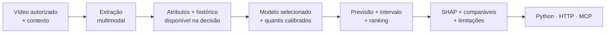

<p align="center"></p>

<h1 align="center">Galaxies · Creative Intelligence</h1>
<p align="center">Prever visualizações antes de publicar.<br>Medir se o modelo supera o histórico do canal em dados reservados.</p>

<p align="center"><a href="docs/REACH_RESULTS.md">Resultado mais recente</a> · <a href="docs/REVISED_STUDY.md">Método e busca de dados</a> · <a href="docs/FULL_VIDEO_RESULTS.md">Vídeos completos</a> · <a href="docs/MODEL_CASE.md">O case de modelagem</a> · <a href="docs/QUICKSTART.md">Começar</a> · <a href="docs/DATA.md">Preparar dados</a></p>

> **Resultado real — 17/10/2026:** houve ganho estatisticamente positivo em **27.505 vídeos reservados de 10.621 canais**: erro de previsão **3,7% menor** que o histórico e acerto de ordenação **60,6% contra 49,3%**. A redução do erro ficou abaixo da meta registrada de 5%. A fonte é de 2016, com metadados e séries diárias; este resultado ainda não valida Shorts atuais, análise de imagem/fala ou campanhas da Galaxies.

## Entenda o resultado em um minuto

O modelo começa pelo desempenho habitual do canal. Ajusta a previsão pela duração, calendário e comportamento recente, e consulta até cinco publicações anteriores com títulos parecidos. O alvo são as visualizações na data de publicação e nas seis datas seguintes. Nenhum engajamento inicial do próprio vídeo entra na previsão.

| Como prever | Redução do erro sobre o histórico ↑ | Acerto ao ordenar vídeos do mesmo canal ↑ |
|---|---:|---:|
| Histórico do canal | Referência | 49,3% |
| Histórico + contexto | 2,7% | 58,9% |
| **Histórico + contexto + título** | **3,7%** | **60,6%** |

A redução usa o erro em log, com peso igual por canal. A ordenação compara vídeos publicados pelo mesmo canal na mesma semana e dá peso igual aos canais. O conteúdo do título acrescentou **1,1% de redução do erro** e **1,8 ponto percentual de acerto** sobre o contexto, com intervalos de 95% favoráveis. O critério de ordenação foi cumprido; o de redução relevante do erro, de pelo menos 5% contra ambas as referências, não foi.


**Leia o [resultado explicado](docs/REACH_RESULTS.md)**: números, incerteza, cinco exemplos incluindo erros e todos os recortes. O modelo acertou a faixa ampla entre metade e dobro do valor real em **73,8%** dos vídeos. Para canais sem histórico, o ganho foi apenas **0,4%**; a utilidade depende do contexto disponível.

Os 263.317 registros preparados vieram de uma fonte pública com categorias Automotivo e Howto & Style. Os vídeos finais eram novos para a avaliação, mas foram publicados em agosto de 2016. As regras, revisões feitas no desenvolvimento e limitações estão no [protocolo](docs/REVISED_STUDY.md). A [seleção foi publicada antes da abertura final](https://github.com/Gui0206/case-galaxies/commit/660999e).

A análise de [imagem, fala e edição em vídeos completos](docs/FULL_VIDEO_RESULTS.md) permanece implementada, com o estudo anterior de retenção em 945 vídeos e sem ganho confirmado. Os [dois testes anteriores de metadados](docs/REAL_DATA_RESULTS.md) também permanecem preservados. Nenhum modelo foi promovido para produção.

## A qualidade está na avaliação do modelo

O estudo de alcance compara **30 candidatos e oito referências históricas** em duas janelas de desenvolvimento. Congela modelos, dados e código antes da avaliação final. Ele usa referências com até 50 publicações maduras, modelos residuais, texto lexical/semântico e recuperação de comparáveis. A escolha final minimiza o erro por canal, sem consultar o teste.

O [case de modelagem](docs/MODEL_CASE.md) também documenta o protocolo geral da aplicação e os estudos anteriores. A evidência sintética verifica a implementação; a eficácia real é medida nos estudos públicos, com suas limitações explícitas.

## Execute em três comandos

Requisitos: [uv](https://docs.astral.sh/uv/getting-started/installation/), Python 3.12 (gerenciado pelo uv) e OpenMP para LightGBM (`brew install libomp` no macOS; `libgomp1` no Ubuntu). FFmpeg é necessário para vídeos locais.

```bash
uv sync --frozen --group dev
uv run galaxies demo
uv run galaxies serve
```

Abra **[localhost:8000](http://127.0.0.1:8000)**. A demonstração gera 2.160 posts fictícios de 24 canais, treina um modelo e ativa uma versão explicitamente sintética. Nenhuma chave de API é necessária. Os cartões ilustrados da interface representam cenários simulados, não vídeos analisados.

## Da entrada à decisão



**O modelo calcula os números.** LangGraph organiza validação, atributos e explicação; a saída é estruturada e inspecionável. O texto explicativo padrão é determinístico e usa as contribuições reais do modelo. O VLM opcional observa o vídeo; não inventa métricas futuras.

Esse é o fluxo da aplicação de demonstração, que continua usando dados sintéticos. Os estudos reais de alcance e retenção são executados por scripts e relatórios próprios. O novo estudo de alcance preserva modelos e intervalos calibrados em `.runtime/reports/reach/`, mas não ativa o preditor da interface.

## O que está implementado

| Área | Entrega |
|---|---|
| Experiência visual | Visão geral, comparação, intervalos, explicações, avaliação, dados, treinamento e guia |
| Contratos de dados | Pydantic + JSON Schema; JSONL/JSON/Parquet; auditoria de origem, horizonte e disponibilidade temporal |
| Prevenção de vazamento | Histórico ponto a ponto no tempo; expurgo de rótulos imaturos; deduplicação; separação de campanhas |
| Modelagem | Ridge, CatBoost, LightGBM e blend; alvos absolutos/residuais; quantis calibrados por setor |
| Experimentos | Competição em três janelas, contexto forte, ablações, controles negativos, seeds e canais não vistos; seleção congelada e teste final de uso único |
| Testes públicos reais | Novo estudo de alcance com ganho modesto confirmado, ordenação superior ao histórico/contexto, hashes e teste final único; resultados anteriores preservados |
| Vídeos completos | [Imagem, fala e edição](docs/FULL_VIDEO_METHOD.md) em 945 vídeos íntegros; teste reservado com 177 vídeos; vantagem não confirmada |
| Avaliação | MAE, MAE em log, MAPE com zeros explícitos, Spearman, pares, arrependimento de seleção, F1 de faixas, interval score, cobertura/largura e médias equilibradas por canal |
| Explicação | SHAP de árvores/decomposição linear, comparáveis históricos, evidências temporais, abstenção e rastros em JSON |
| Vídeo local | FFmpeg, atributos visuais/acústicos, cache por conteúdo e versão |
| Extratores opcionais | Whisper, OpenCLIP, OCR e rubrica estruturada via Ollama |
| Coleta | Snapshots oficiais de metadados do YouTube e montagem de alvos em horizonte fixo |
| Operação | Fila SQLite, retomada explícita de jobs interrompidos, registro de versões e promoção controlada |
| Integração | Função Python, FastAPI/OpenAPI e MCP stdio com saída estruturada |
| Validação prospectiva | Registro imutável antes da publicação; inclusão de resultado no horizonte; relatório de erro/cobertura |
| Qualidade | Testes de dados, modelo, API, vídeo real gerado e protocolo MCP; CI; lockfile |

## Navegue pela documentação

| Quero… | Leia |
|---|---|
| Saber se o modelo supera o histórico | [Resultado de alcance](docs/REACH_RESULTS.md) |
| Entender a seleção da base e do modelo | [Protocolo revisado](docs/REVISED_STUDY.md) |
| Saber se imagem, fala e edição ajudaram | [Resultado com vídeos completos](docs/FULL_VIDEO_RESULTS.md) |
| Conferir os testes anteriores de metadados | [Ken Jee e YouTube Trending](docs/REAL_DATA_RESULTS.md) |
| Avaliar a qualidade do modelo | [Case de modelagem e evidência](docs/MODEL_CASE.md) |
| Rodar e explorar | [Guia rápido](docs/QUICKSTART.md) |
| Entender módulos e fluxos | [Arquitetura](docs/ARCHITECTURE.md) |
| Importar uma base real sem vazamento | [Dados e coleta](docs/DATA.md) |
| Avaliar a validade dos resultados | [Metodologia](docs/METHODOLOGY.md) |
| Ativar extração multimodal | [Processamento de mídia](docs/MULTIMODAL.md) |
| Conectar a ferramenta à persona | [Python, API e MCP](docs/INTEGRATION.md) |
| Operar, monitorar e recuperar | [Operação](docs/OPERATIONS.md) |
| Apresentar o case com honestidade | [Roteiro de demonstração](docs/DEMO.md) |
| Ver decisões e limites de escopo | [Decisões técnicas](docs/DECISIONS.md) |
| Conferir o que foi testado | [Registro de verificação](docs/VERIFICATION.md) |

## Verifique a implementação

```bash
uv run ruff check src tests scripts
uv run ruff format --check src tests scripts
uv run pytest
uv run galaxies doctor
```

Os testes geram os próprios dados e não fazem chamadas a modelos remotos. O teste de vídeo usa FFmpeg quando disponível. Os extratores opcionais exigem instalação e pesos próprios; eles não são baixados pela suíte padrão.

## Estrutura

```text
src/galaxies/
  schemas.py       contratos e disponibilidade temporal
  data.py          auditoria, histórico e partições
  features.py      atributos e projeções ajustadas no treino
  media.py         vídeo, áudio, OCR, CLIP e VLM local
  estimators.py    famílias, alvos residuais e atribuições
  model.py         treino, calibração, avaliação e SHAP
  protocol.py      cortes, candidatos e regra de seleção
  research.py      competição, diagnósticos e avaliação final
  reach_study.py   alcance semanal, histórico, comparáveis e avaliação reservada
  public_benchmark.py  estudo público de metadados com alvos por calendário
  shortvideo.py      aquisição de vídeos completos e histórico de retenção
  deep_media.py     imagem, fala e semântica com pesos fixados
  video_structure.py  cortes em todos os frames e movimento
  retention_benchmark.py  teste temporal de retenção com escolha congelada
  experiments.py   suíte exploratória complementar
  service.py       fluxo LangGraph e decisões
  registry.py      versões, integridade e ativação
  jobs.py          fila persistente
  prospective.py   registro antes da publicação
  quality.py       monitoramento e concordância dos extratores
  api.py           HTTP e interface visual
  mcp_server.py    ferramentas para agentes
  cli.py           comandos reproduzíveis
  web/             interface sem dependências de frontend
docs/              documentação visual e contratos
examples/          requisições e configurações executáveis
tests/             verificações de comportamento
```

Dados, modelos, vídeos e rastros ficam em `.runtime/`, ignorado pelo Git. O repositório não contém arquivos do briefing, credenciais privadas, dados de clientes ou vídeos de terceiros. O acesso público ao dataset usa as informações de download publicadas pelos próprios autores.

Desenvolvido por **Guilherme Holanda**, no contexto Inteli Academy × Galaxies.
