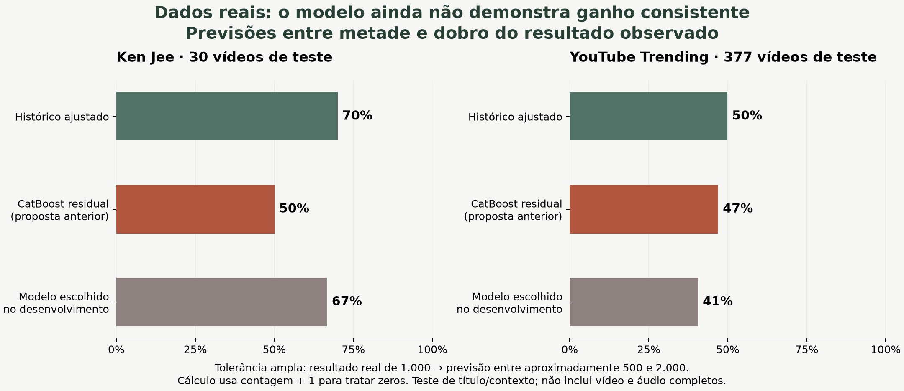
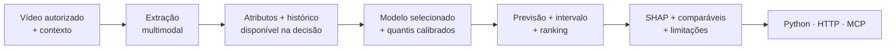

<p align="center"></p>

<h1 align="center">Galaxies · Creative Intelligence</h1>
<p align="center">Compare criativos antes da publicação.<br>Previsões estatísticas, incerteza explícita e evidências à vista.</p>

<p align="center"><a href="docs/REAL_DATA_RESULTS.md">Resultado em dados reais</a> · <a href="docs/MODEL_CASE.md">O case de modelagem</a> · <a href="docs/QUICKSTART.md">Começar</a> · <a href="docs/METHODOLOGY.md">Entender a avaliação</a> · <a href="docs/DATA.md">Preparar dados</a> · <a href="docs/INTEGRATION.md">Integrar</a></p>

> **Estado da evidência — 17/10/2026:** os preditores foram treinados e testados em duas bases públicas reais. **Ainda não demonstraram vantagem consistente sobre um histórico bem calculado.** O teste usa título, duração quando disponível e contexto; não valida vídeo/áudio completos nem campanhas da Galaxies. Nenhum modelo desse estudo foi promovido para produção.

## O que aconteceu com dados reais

Usamos 196 vídeos do canal Ken Jee e 2.534 vídeos do YouTube Trending. Os períodos finais, reservados antes da escolha do modelo, contêm **30 e 377 vídeos**. O CatBoost residual anterior ficou próximo do histórico ajustado no erro médio; a seleção automática entre famílias também não produziu ganho consistente.



O gráfico aceita uma faixa ampla: para um resultado real de 1.000 visualizações, aproximadamente 500–2.000. Não representa acerto exato da contagem. **Leia primeiro o [resultado em dados reais](docs/REAL_DATA_RESULTS.md)**: explicação simples, exemplos de previsões, comparação completa, fontes, limitações e comandos para reproduzir.

## A qualidade está na avaliação do modelo

O núcleo compara **12 configurações de Ridge, CatBoost, LightGBM e blend em três janelas temporais**, congela a escolha e só então abre uma avaliação final. O conteúdo precisa acrescentar valor sobre uma referência forte que já conhece o canal. Contagens, ranking, incerteza, ablações e canais novos são avaliados separadamente.

O **[case de modelagem](docs/MODEL_CASE.md)** descreve a arquitetura e o estudo sintético anterior. O estudo público usa duas janelas de desenvolvimento devido ao tamanho das amostras após expurgo temporal; preserva a escolha congelada e registra as falhas. A evidência sintética verifica a implementação, mas não substitui o resultado real acima.

## Execute em três comandos

Requisitos: [uv](https://docs.astral.sh/uv/getting-started/installation/), Python 3.12 (gerenciado pelo uv) e OpenMP para LightGBM (`brew install libomp` no macOS; `libgomp1` no Ubuntu). FFmpeg é necessário para vídeos locais.

```bash
uv sync --frozen --group dev
uv run galaxies demo
uv run galaxies serve
```

Abra **[localhost:8000](http://127.0.0.1:8000)**. A demonstração gera 2.160 posts fictícios de 24 canais, treina um modelo e ativa uma versão explicitamente sintética. Nenhuma chave de API é necessária. Os cartões ilustrados da interface representam cenários simulados, não vídeos analisados.

## Da entrada à decisão



**O modelo calcula os números.** LangGraph organiza validação, atributos e explicação; a saída é estruturada e inspecionável. O texto explicativo padrão é determinístico e usa as contribuições reais do modelo. O VLM opcional observa o vídeo; não inventa métricas futuras.

## O que está implementado

| Área | Entrega |
|---|---|
| Experiência visual | Visão geral, comparação, intervalos, explicações, avaliação, dados, treinamento e guia |
| Contratos de dados | Pydantic + JSON Schema; JSONL/JSON/Parquet; auditoria de origem, horizonte e disponibilidade temporal |
| Prevenção de vazamento | Histórico ponto a ponto no tempo; expurgo de rótulos imaturos; deduplicação; separação de campanhas |
| Modelagem | Ridge, CatBoost, LightGBM e blend; alvos absolutos/residuais; quantis calibrados por setor |
| Experimentos | Competição em três janelas, contexto forte, ablações, controles negativos, seeds e canais não vistos; seleção congelada e teste final de uso único |
| Testes públicos reais | Dois estudos de metadados, duas janelas de desenvolvimento, versões/hashes das fontes, referências simples e resultados negativos preservados |
| Avaliação | MAE, MAE em log, MAPE com zeros explícitos, Spearman, pares, arrependimento de seleção, F1 de faixas, interval score, cobertura/largura e médias equilibradas por canal |
| Explicação | SHAP de árvores/decomposição linear, comparáveis históricos, evidências temporais, abstenção e rastros em JSON |
| Vídeo local | FFmpeg, atributos visuais/acústicos, cache por conteúdo e versão |
| Extratores opcionais | Whisper, OpenCLIP, OCR e rubrica estruturada via Ollama |
| Coleta | Snapshots oficiais de metadados do YouTube e montagem de alvos em horizonte fixo |
| Operação | Fila SQLite, retomada explícita de jobs interrompidos, registro de versões e promoção controlada |
| Integração | Função Python, FastAPI/OpenAPI e MCP stdio com saída estruturada |
| Validação prospectiva | Registro imutável antes da publicação; inclusão de resultado no horizonte; relatório de erro/cobertura |
| Qualidade | Testes de dados, modelo, API, vídeo real gerado e protocolo MCP; CI; lockfile |

## Navegue pela documentação

| Quero… | Leia |
|---|---|
| Saber se ajudou em dados reais | [Resultados reais, em linguagem simples](docs/REAL_DATA_RESULTS.md) |
| Avaliar a qualidade do modelo | [Case de modelagem e evidência](docs/MODEL_CASE.md) |
| Rodar e explorar | [Guia rápido](docs/QUICKSTART.md) |
| Entender módulos e fluxos | [Arquitetura](docs/ARCHITECTURE.md) |
| Importar uma base real sem vazamento | [Dados e coleta](docs/DATA.md) |
| Avaliar a validade dos resultados | [Metodologia](docs/METHODOLOGY.md) |
| Ativar extração multimodal | [Processamento de mídia](docs/MULTIMODAL.md) |
| Conectar a ferramenta à persona | [Python, API e MCP](docs/INTEGRATION.md) |
| Operar, monitorar e recuperar | [Operação](docs/OPERATIONS.md) |
| Apresentar o case com honestidade | [Roteiro de demonstração](docs/DEMO.md) |
| Ver decisões e limites de escopo | [Decisões técnicas](docs/DECISIONS.md) |
| Conferir o que foi testado | [Registro de verificação](docs/VERIFICATION.md) |

## Verifique a implementação

```bash
uv run ruff check src tests scripts
uv run ruff format --check src tests scripts
uv run pytest
uv run galaxies doctor
```

Os testes geram os próprios dados e não fazem chamadas a modelos remotos. O teste de vídeo usa FFmpeg quando disponível. Os extratores opcionais exigem instalação e pesos próprios; eles não são baixados pela suíte padrão.

## Estrutura

```text
src/galaxies/
  schemas.py       contratos e disponibilidade temporal
  data.py          auditoria, histórico e partições
  features.py      atributos e projeções ajustadas no treino
  media.py         vídeo, áudio, OCR, CLIP e VLM local
  estimators.py    famílias, alvos residuais e atribuições
  model.py         treino, calibração, avaliação e SHAP
  protocol.py      cortes, candidatos e regra de seleção
  research.py      competição, diagnósticos e avaliação final
  public_benchmark.py  estudo público de metadados com alvos por calendário
  experiments.py   suíte exploratória complementar
  service.py       fluxo LangGraph e decisões
  registry.py      versões, integridade e ativação
  jobs.py          fila persistente
  prospective.py   registro antes da publicação
  quality.py       monitoramento e concordância dos extratores
  api.py           HTTP e interface visual
  mcp_server.py    ferramentas para agentes
  cli.py           comandos reproduzíveis
  web/             interface sem dependências de frontend
docs/              documentação visual e contratos
examples/          requisições e configurações executáveis
tests/             verificações de comportamento
```

Dados, modelos, vídeos e rastros ficam em `.runtime/`, ignorado pelo Git. O repositório não contém arquivos do briefing, credenciais, dados de clientes ou vídeos de terceiros.

Desenvolvido por **Guilherme Holanda**, no contexto Inteli Academy × Galaxies.
