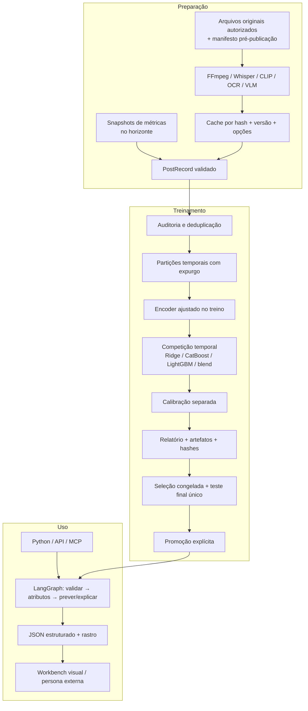

# Arquitetura

O núcleo estatístico é compartilhado entre Python, HTTP e MCP. A interface é uma forma de inspecionar a ferramenta; não contém uma segunda implementação de predição.



## Fronteiras

| Módulo | Responsabilidade | Não faz |
|---|---|---|
| `schemas` | Validar contratos, datas e atributos permitidos | Aceitar métricas pós-publicação como features |
| `data` | Criar partições e consultar histórico conhecido | Reconstruir estatísticas históricas inexistentes |
| `features` | Hashing de n-grams + SVD; PCA visual; contexto | Ajustar projeções com dados de teste |
| `media` | Extrair dados de vídeos locais | Baixar vídeos de terceiros ou contornar bloqueios |
| `estimators` | Estimar alvos absolutos/residuais nas quatro famílias | Escolher família olhando o teste final |
| `protocol` / `research` | Congelar competição, diagnosticar e avaliar uma única seleção final | Declarar eficácia real com dados artificiais |
| `model` | Treinar e avaliar números e intervalos | Fazer afirmações causais |
| `service` | Orquestrar, comparar, explicar e abster-se | Criar personas sintéticas |
| `registry` | Verificar hashes e ativar versões | Ativar automaticamente o último treino |
| `jobs` | Persistir estados e serializar treinos da API/MCP | Reiniciar silenciosamente uma execução perdida |

## Estado persistente

```text
.runtime/
  datasets/                versões importadas
  media/                   uploads locais com identificadores aleatórios
  features/                extrações cacheadas
  models/model-.../
    point.json              configuração/coeficientes do preditor
    point.cbm / point.lgb.txt componentes nativos quando aplicáveis
    quantiles.cbm           regressor de quantis
    encoder.json + .npz     transformações sem pickle
    history.jsonl           observações para consultas ponto no tempo
    reference.jsonl         referências provenientes do treino
    partitions.json         IDs de cada partição
    test_predictions.json   resultados auditáveis
    report.json             métricas, proveniência e limites
    manifest.json           hashes de todos os artefatos
  models/active.json        versão selecionada
  runs/                    entradas, features e saídas por análise
  reports/research-.../    plano, desenvolvimento, seleção e final
  reports/final-evaluated-* registro de uso do teste final
  reports/                 demais suítes e comparações
  state.sqlite3            jobs + registro prospectivo
```

O histórico preservado no modelo pode conter observações posteriores ao treino, inclusive resultados de teste já amadurecidos, para simular atualização online de contexto. Toda consulta filtra estritamente `observed_at < as_of`. Esses resultados não ajustam os pesos do preditor. Os comparáveis exibidos vêm apenas da partição de treino.

## Consistência da comparação

Uma comparação resolve a versão ativa uma vez. Todos os criativos recebem o mesmo canal, setor, horizonte e momento de decisão. A versão não muda no meio do ranking se outro processo ativar um modelo.

O grafo LangGraph é propositalmente pequeno e determinístico. Os rastros são persistidos após cada predição concluída. Checkpoints intermediários de inferência não são necessários: a execução é curta e repetível. Treinamentos interrompidos são reiniciados integralmente por uma nova execução identificável.
