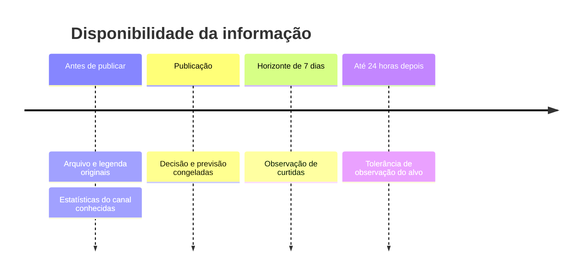

# Dados que sustentam uma previsão

**Pergunta de controle:** essa informação estava disponível no momento em que a escolha seria feita?

## Fonte da demonstração real atual: SMTPD

A [SMTPD](SMTPD_PROTOCOL.md) foi efetivamente usada. O CSV inicialmente não oferecia datas suficientes; posteriormente elas e os IDs estáveis dos canais foram recuperados pela **YouTube Data API v3**, sem usar a popularidade atual como alvo histórico. Dos 12.655 IDs sem duplicatas, **8.112 vídeos de 5.291 canais** tiveram metadados públicos utilizáveis.

O alvo é a contagem nominal da primeira semana, recuperada conforme a codificação da fonte. O histórico recebe resultados somente após publicação + oito dias. Os timestamps exatos de coleta não estão no CSV; essa margem não os inventa. O treino principal tinha 796 vídeos com histórico, a calibração 129 e o teste reservado 515 vídeos de 165 canais. A investigação auxiliar de 40.781 vídeos anteriores não cria outra amostra de confirmação.

A coleta de mídia contabilizou 669 itens: 667 baixados, 662 extrações válidas e falhas preservadas. O recorte multimodal reservado tem 219 vídeos completos. A [avaliação](SMTPD_RESULTS.md) não confirmou vantagem sobre histórico e contexto. Howto & Style é mais amplo que moda/beleza; a seleção e os históricos incompletos limitam a generalização.

Vídeos, transcrições completas, pesos e dados brutos permanecem locais em `.runtime/`. Os [resultados e previsões versionados](results/smtpd/final/) permitem auditar a conclusão sem baixar a base ou treinar novamente. Não confundir ausência dos arquivos grandes no Git com ausência de dados reais no projeto.

O [piloto prospectivo de quatro canais](CHANNEL_PILOT.md) foi interrompido por solicitação do usuário: zero vídeos novos, zero resultados maduros e agendamento desativado. Não há canal parceiro disponível nem base da Academy a aguardar. Não há autorização para nova coleta nesta atualização.

## Outras bases públicas já testadas (estudos históricos)

O [estudo público de metadados](REAL_DATA_RESULTS.md) usa Ken Jee (196 vídeos elegíveis) e YouTube Trending (2.534 vídeos elegíveis). Fontes, versões, hashes, alvos por calendário e resultados estão documentados. **O modelo não demonstrou ganho consistente sobre o histórico.**

Essas bases não comprovam versões originais anteriores à publicação nem observações em exatamente 168 horas. Por isso são processadas por `public_benchmark.py`, separadamente do contrato abaixo. Não inventamos datas ou setores para importá-las como dados prontos para produção. Os CSVs ficam em `.runtime/public/`, ignorado pelo Git; não são a base sintética da interface.

O [estudo de vídeos completos](FULL_VIDEO_METHOD.md) usa uma terceira fonte, Tsinghua ShortVideo: arquivos de vídeo e logs com criador, duração e tempo assistido. O alvo é retenção no primeiro dia observado pelo painel, porque não há data de publicação verificável. `shortvideo.py` e `retention_benchmark.py` mantêm esse alvo separado do contrato de contagens; não preenchem a data de publicação com uma suposição. Vídeos completos, transcrições e logs permanecem fora do Git.

Foram aceitos 945 dos 954 arquivos solicitados: oito tinham duração incompatível e um estava incompleto na fonte. O [resultado reservado com 177 vídeos](FULL_VIDEO_RESULTS.md) não confirmou vantagem da análise completa sobre o histórico.



## Nova fonte para alcance semanal

O [protocolo revisado](REVISED_STUDY.md) usa Beyond Views / Harvard Dataverse, com séries diárias de vídeos publicados em julho e agosto de 2016. A auditoria de Automotivo e Howto & Style encontrou 277.727 registros e manteve **263.317 vídeos de 68.411 canais**. Foram excluídos 12.954 registros sem todos os sete dias explícitos, 654 com início da série diferente da data de publicação, três com duração inválida e 799 títulos duplicados dentro do mesmo canal.

O alvo soma a data de publicação e as seis datas seguintes. A disponibilidade do resultado é convencionada como publicação + nove datas; não se apresenta esse horário como se fosse um timestamp de coleta observado. `reach_study.py` mantém essa convenção separada do contrato de produção. Títulos e metadados são retrospectivos, a amostra não contém todos os uploads e os vídeos originais não acompanham a base. A licença declarada do registro é CC0 1.0; origem, hash integral e hashes dos dois arquivos extraídos são preservados.

O [teste final de alcance](REACH_RESULTS.md) confirmou redução de erro de 3,7% sobre o histórico e melhora de ordenação, mantendo explícitos o limite de 2016 e a ausência de mídia original.

A base da Academy mencionada no TAPI não existe, conforme informado pelo usuário. Nenhuma evidência deste projeto depende de acesso presumido a ela.

## Contrato genérico de importação — diferente dos adaptadores dos estudos públicos

Veja [exemplo completo](../examples/post-record.json) e [JSON Schema](schemas/post-record.json).

| Campo | Significado |
|---|---|
| `creative_id`, `channel_id` | Identificadores estáveis |
| `sector` | `beleza`, `automotivo` ou `moda` |
| `published_at` | Data de publicação com fuso |
| `features_available_at` | Quando o conteúdo/contexto original estava disponível |
| `observed_at` | Quando a métrica-alvo foi efetivamente medida |
| `metric`, `horizon_days`, `target` | Métrica, horizonte e contagem observada |
| `subscribers`, `channel_stats_observed_at` | Estatística do canal e quando ela era conhecida; ambos ausentes quando desconhecidos |
| `caption`, `transcript`, `features` | Conteúdo e atributos anteriores à publicação |
| `visual_embedding` | Vetor opcional produzido pelo mesmo encoder em toda a base |
| `evidence` | Observações com atributo e intervalo de segundos |
| `attributes_source` | `media_extraction`, `human_annotation` ou `simulation` |
| `content_hash`, `content_group` | Identidade do arquivo e grupo de campanha/variações |
| `source`, `usage_basis` | Origem e justificativa de uso dos dados |
| `synthetic` | Identifica dados artificiais explicitamente |
| `distribution` | `organic`, `paid` ou `unknown`; não inferir ausência de mídia paga |

`features_available_at` é a disponibilidade do **conteúdo original**, não o horário em que um algoritmo processou o arquivo. Analisar hoje um arquivo imutável comprovadamente disponível antes da publicação é diferente de usar hoje uma legenda que foi editada depois.

Declarar um tempo ou uma licença no JSON não prova sua veracidade. Essa proveniência precisa ser auditada na fonte.

Escalas dos atributos: `cta` e `demonstration` são binários (0 ou 1); as demais notas de rubrica variam de 0 a 10. Luminosidade, saturação, variação entre frames e proporção de silêncio usam 0–1. Duração em segundos precisa ser positiva; contagens, taxas e energia não podem ser negativas. Use `null` ou omita uma chave desconhecida.

## Regras automáticas

- Uma base por métrica/horizonte; não misturar curtidas e visualizações.
- Dados sintéticos e reais não se misturam.
- Atributos como `views`, `likes`, `comments` e `target` não são aceitos dentro de `features`.
- Inscritos exigem um timestamp anterior ou igual à publicação.
- O alvo deve ser medido entre `publicação + horizonte` e esse instante mais 24 horas.
- Ausência de uma métrica é desconhecimento, não zero.
- Duplicatas exatas são removidas antes da partição; grupos de conteúdo não atravessam partições.
- A anotação `content_group` precisa ser curada: não existe detecção automática de toda variação semântica/republicação.

## Formatos e importação

```bash
uv run galaxies validate minha-base.jsonl
uv run galaxies import-data minha-base.jsonl --name cliente-v1.jsonl
```

JSON contém uma lista. JSONL contém um objeto por linha. Parquet mantém objetos complexos (`features`, `visual_embedding`, `evidence`) serializados como JSON; `save_records` produz o formato correto. CSV de terceiros precisa ser adaptado para esse contrato, com semântica de datas e métricas preservada.

## Referência para coletar observações oficiais — coleta atualmente interrompida

```bash
export YOUTUBE_API_KEY="sua-chave"
uv run galaxies snapshot VIDEO_ID_1,VIDEO_ID_2 snapshot-2026-10-06.json
```

Esse comando coleta **os números atuais**. Não baixa vídeo e não transforma contagens atuais em métricas históricas de sete dias. O coletor também oferece `channel_video_ids`, por playlist de uploads, para descoberta sem pesquisa repetida.

Crie um manifesto de criativos com os campos de `PostRecord`, exceto `metric`, `horizon_days`, `target` e `observed_at`. Consolide os snapshots numa lista JSON e execute:

```bash
uv run galaxies assemble manifesto.json observacoes.json base-7d.jsonl --metric likes --horizon-days 7
```

Registros sem observação no horizonte permanecem pendentes; o comando informa seus IDs. Perder a janela exige descartar esse alvo ou usar outro horizonte com observação válida. Não interpole retrospectivamente sem um experimento separado.

## Origem, retenção e acesso

Use arquivos originais de criadores que autorizaram seu processamento ou datasets com condições compatíveis. Consulte as [políticas da API](https://developers.google.com/youtube/terms/developer-policies) e as [condições adicionais para métricas/armazenamento](https://developers.google.com/youtube/terms/derived-metrics-policy) para o caso concreto. Acesso público não equivale a autorização irrestrita de armazenamento, agregação, download e treinamento.

A [auditoria inicial de fontes](results/public/sources.json) registrou a exclusão inicial da SMTPD por falta de datas. **Essa decisão foi superada pela recuperação oficial de metadados e pelo estudo SMTPD documentado no início desta página.** O arquivo de auditoria foi preservado como registro histórico. MicroLens foi considerado e não baixado: seus timestamps de interação não estabelecem o alvo comum após publicação.

Não transfira rótulos de uma plataforma para outra. Para novos clientes ou anúncios, mantenha um perfil próprio de alvo/horizonte, atributos e validação.
