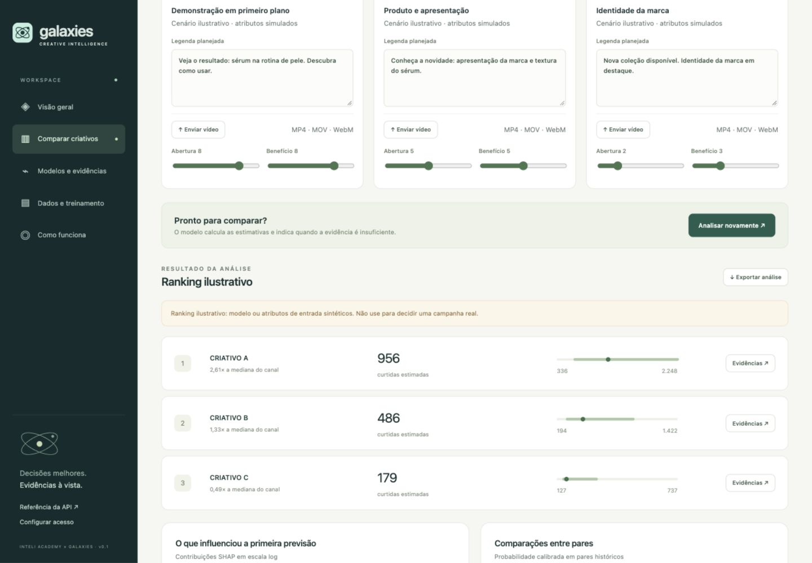
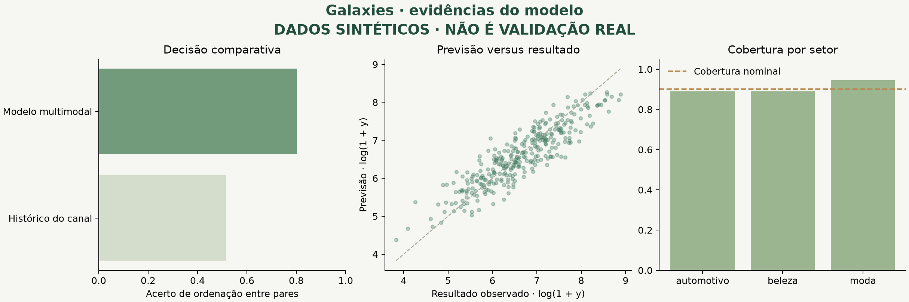

# Apresente o case pelo que pode ser verificado

> **Registro histórico da demo sintética inicial.** Os 2.160 posts e números abaixo são artificiais e não representam a entrega atual. Para apresentar o case, comece pela [interface real](REAL_DEMO.md), pelo [teste SMTPD](SMTPD_RESULTS.md) e pelo [estado final](CURRENT_STATE.md). Há avaliações reais; a conclusão é ausência de ganho consistente, não ausência de dados reais. A segunda execução sintética de 2.400 posts também é histórica.

## Mensagem da demonstração inicial (histórica)

“Construímos uma ferramenta que recebe criativo e contexto, calcula uma previsão estatística, explicita sua incerteza e entrega evidências para uma decisão pré-publicação. A engenharia está demonstrada; a eficácia comercial depende da validação em dados reais.”

## Roteiro visual

| Passo | Tela/ação | Evidência |
|---|---|---|
| 1 | Visão geral | Origem e tamanho da base, perfil do modelo e horizonte |
| 2 | Comparar os três cenários | Previsões calculadas, ranking e intervalos |
| 3 | Abrir “Evidências” | SHAP, comparáveis e limitações |
| 4 | Exportar análise | Contrato consumível por outra plataforma |
| 5 | Enviar vídeo original autorizado | Extração real e atributos ausentes explicitamente sinalizados |
| 6 | Modelos e evidências | Baseline, partições temporais, erro e cobertura |
| 7 | Dados e treinamento | Auditoria e criação de nova versão em segundo plano |
| 8 | Mostrar o MCP | A mesma ferramenta disponível para uma persona externa |
| 9 | Validação prospectiva | Registro antes da publicação e observação depois |



## Resultados reproduzíveis da demonstração



Os valores dessa figura vêm de uma execução real do pipeline sobre **dados gerados artificialmente**. O gerador contém relações explícitas entre atributos e alvo; aprendê-las verifica a implementação, não comprova que essas relações existem no YouTube.

O [relatório de demonstração](results/demo-report.json) e o [resumo de experimentos](results/experiments.json) registram as execuções utilizadas. Seeds, configurações, ambiente e tamanho das partições estão preservados. Reexecutar em outro ambiente pode produzir pequenas variações numéricas.

### Leitura dos resultados sintéticos

Na execução padrão de 180 iterações máximas, o modelo obteve **80,3% de acerto entre pares**, frente a **51,5%** da mediana histórica. A cobertura observada foi **90,7%** para o intervalo nominal de 90%, sobre 324 criativos de teste.

A suíte de desenvolvimento usa **outro recorte temporal**, 80 iterações máximas e preserva a janela final original. Os números abaixo não devem ser comparados diretamente aos 80,3% acima.

| Experimento no desenvolvimento | Acerto em pares |
|---|---:|
| Contexto do canal | 47,5% |
| Contexto + texto | 58,1% |
| Contexto + texto + atributos visuais/acústicos | 60,9% |
| Todos os blocos, incluindo rubrica | 73,5% |
| Ridge | 75,0% |
| CatBoostRanker | 74,5% |

O gerador contém relações simples e explícitas, o que favorece modelos lineares. Esses resultados não demonstram superioridade universal do CatBoost. A arquitetura oferece contagens, quantis e explicações em uma mesma implementação; a escolha para produção depende da comparação em dados reais.

No experimento de canais excluídos, a coorte **sem canais vistos no treino** obteve 67,5% de acerto e somente 73,2% de cobertura nominal de 90%. Esse resultado expõe uma limitação concreta de generalização e sustenta a regra de abstenção para canais sem histórico. O agregado do experimento não deve esconder essa coorte.

Para regenerar a figura, use o ID impresso pelo comando `demo`:

```bash
uv run python scripts/render_evaluation.py .runtime/models/MODEL_ID docs/assets/evaluation.png
```

## Demonstre limites com intenção

- Remova atributos: o sistema deve sinalizar informação insuficiente.
- Use um canal sem histórico: deve explicitar a limitação.
- Compare estimativas próximas: um modelo real elegível pode devolver empate técnico.
- Altere o horizonte: uma versão incompatível deve recusar a chamada.
- Tente usar modelo sintético em registro prospectivo: deve recusar.

Na demonstração padrão, toda recomendação real permanece bloqueada por ser sintética. “Empate técnico” e “recomendação” são estados de uma versão real elegível; não altere rótulos para simulá-los como resultados reais.

## O que ainda precisa de evidência externa

| Afirmação desejada | Evidência necessária |
|---|---|
| Prevê desempenho real | Base autorizada com horizontes e proveniência verificáveis |
| Conteúdo multimodal acrescenta valor | Ablações nos mesmos IDs e protocolo |
| Generaliza para novos clientes | Teste por canal e avaliação por setor |
| Ajuda antes de publicar | Criativos recebidos e previsões registradas antes da publicação |
| Melhora resultado de campanha | Experimento controlado de decisão/distribuição |
| Está integrado ao Nexus | Execução aprovada no ambiente real da Galaxies |

Não use os percentuais de demonstração como acurácia comercial, nem converta ranking em economia de verba ou aumento de CTR.
