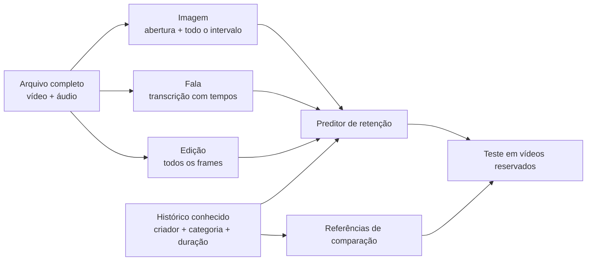

# Análise do vídeo completo e teste de retenção

Este estudo pergunta: **imagem, fala e edição ajudam a prever quanto do vídeo as pessoas assistem, além do que já sabemos pelo histórico do criador?** A comparação usa uma base independente dos testes anteriores de metadados.

O estudo tem um alvo específico. Se uma pessoa assiste 30 segundos de um vídeo de 60 segundos, sua retenção é 50%. Calculamos a média dessa proporção nas observações do primeiro dia em que o vídeo aparece no painel. Repetições são limitadas a 100%. Isso **não é previsão de visualizações ou curtidas após a publicação**, nem demonstra que uma mudança na edição causaria melhor resultado.

## O que é analisado



| Parte | Extração executada | O que ela não permite afirmar |
|---|---|---|
| Imagem | OpenCLIP ViT-B/32 em 12 momentos distribuídos pela duração e em 0,5, 1,5 e 2,5 segundos; representação média, abertura e variação visual | Não é compreensão contínua de cada ação nem uma anotação humana de qualidade |
| Fala | Whisper Large v3 Turbo multilíngue via MLX, detecção de fala Silero, transcrição com início/fim de cada trecho; representação semântica multilíngue de todos os trechos | A transcrição pode errar; ela não mede emoção, intenção ou identidade do falante |
| Som | Energia RMS, variação de energia, silêncio por janelas e variação de sinal | Essas medidas não identificam qualidade narrativa ou o efeito causal da música |
| Edição | Decodificação de todos os frames; cortes com PySceneDetect AdaptiveDetector; duração dos planos, ritmo inicial e fluxo óptico em até cerca de oito amostras por segundo | Cortes detectados são estimativas; movimento e flashes podem gerar erros |
| Título | Mesmo encoder multilíngue usado na transcrição | O título exportado pode não ser a versão original anterior à publicação |

O encoder de linguagem é [paraphrase-multilingual-MiniLM-L12-v2](https://huggingface.co/sentence-transformers/paraphrase-multilingual-MiniLM-L12-v2). Textos longos são divididos em trechos; não descartamos silenciosamente o fim da fala. Usamos [OpenCLIP](https://github.com/mlfoundations/open_clip), [MLX Whisper](https://github.com/ml-explore/mlx-examples/tree/main/whisper), o detector de fala distribuído com [Faster Whisper](https://github.com/SYSTRAN/faster-whisper) e [PySceneDetect](https://www.scenedetect.com/docs/latest/api/detectors.html). Revisões dos pesos, hashes, versões de bibliotecas, FFmpeg e código ficam registrados com os atributos.

O detector de fala remove intervalos sem fala antes da transcrição; os tempos são recolocados na posição original do vídeo. Áudio sem fala detectada produz transcrição vazia, sem texto fabricado para preencher o atributo. O modelo maior foi escolhido por viabilidade técnica no Mac, antes do desenvolvimento supervisionado e da abertura do teste. Não houve seleção de transcritor pelos resultados de retenção. O backend CPU com Whisper Small permanece como alternativa explícita, com outra identidade de extrator; seus atributos não são misturados neste estudo.


Cada ponto azul indica uma imagem que alimenta o encoder visual. As linhas vermelhas indicam mudanças de plano detectadas. Os blocos verdes localizam os trechos transcritos. O arquivo de atributos guarda esses tempos e permite conferir a análise no vídeo original. O gráfico ilustra a extração, não uma previsão nem um exemplo escolhido por bom desempenho.

Não há um LLM inventando uma “nota de viralidade”. Os encoders descrevem o conteúdo, e os regressores aprendem a relação com a retenção apenas nos dados de treino. Textos presentes em vídeos são processados como dados, sem executar instruções neles contidas.

## Por que esta base

O [ShortVideo Dataset da Tsinghua, WWW 2025](https://github.com/tsinghua-fib-lab/ShortVideo_dataset) disponibiliza arquivos completos e logs com criador, vídeo, horário da exposição, duração e tempo assistido. A [publicação dos autores](https://arxiv.org/html/2502.05922v1) descreve a coleta em um painel de voluntários e a distribuição dos arquivos para pesquisa.

Auditamos o arquivo público `interaction_sampled.csv`, com **794.053 interações, 31.496 vídeos e 23.242 criadores**, entre 16 e 22 de setembro de 2022 no fuso de Xangai. O hash SHA256 dessa versão é `96cadb70829e853b8d7797bc566928eceeb670f19a8a0b92dbfa58b32372bf87`.

A elegibilidade, definida antes de comparar modelos, exige:

- Arquivo com duração entre 10 e 120 segundos.
- Pelo menos dez observações do vídeo nas primeiras 24 horas do painel.
- Janela e resultados completos dentro do período observado.
- Pelo menos dez eventos anteriores do criador já concluídos no momento da decisão.

Isso produziu **954 vídeos de 678 criadores** para aquisição e extração. Todos os elegíveis são solicitados, sem escolher pelos resultados. O download respeita o máximo de três conexões simultâneas publicado pelos autores. Arquivos, transcrições completas e pesos ficam em `.runtime/`, fora do Git; os relatórios registram exclusões, hashes e números agregados.

Há limitações relevantes: a primeira exposição no painel **não é a data de publicação**; os vídeos foram escolhidos pelo sistema de recomendação da plataforma; o público é uma amostra de voluntários; a elegibilidade depende de haver observações suficientes. A população não representa campanhas brasileiras, todos os uploads de um criador ou criadores sem histórico. Uma única semana não demonstra estabilidade ao longo de meses.

Outras fontes consideradas: SMP-Video exige acesso com aceite e compartilhamento de contato; SnapUGC oferece vídeo e retenção, mas a documentação consultada não estabelece o histórico temporal de criadores necessário aqui; MicroLens não estabelece um horizonte comum após publicação; KuaiRand oferece logs e metadados, mas não os arquivos completos necessários à análise proposta. Nenhuma restrição de acesso foi contornada.

## O teste é separado da escolha do modelo

O [protocolo registrado](results/multimodal/protocol.json) fixa o alvo, os períodos, os candidatos, as exclusões e o critério de sucesso antes do teste final.

| Etapa | Datas no fuso de Xangai | Uso |
|---|---|---|
| Desenvolvimento 1 | Primeira observação de 18/09/2022, 00h–12h | Comparar candidatos treinados apenas com resultados disponíveis antes de 00h |
| Desenvolvimento 2 | 18/09 às 12h até 19/09 às 12h | Nova janela, sem repetir os vídeos da anterior |
| Teste final | Primeira observação a partir de 20/09/2022 às 12h | Avaliar uma única vez a seleção congelada |

Para cada treino, são excluídos resultados que ainda não estariam disponíveis na abertura da janela. A disponibilidade de uma observação de retenção é estimada conservadoramente como início da exposição mais o tempo necessário para conhecer a fração assistida, limitado à duração do vídeo. O alvo de um vídeo só fica disponível depois de fechar suas 24 horas e concluir as observações necessárias.

O histórico de cada previsão usa apenas eventos anteriores já concluídos, excluindo o próprio vídeo. Ele pode se atualizar durante o período final, conforme novas observações anteriores se tornam disponíveis; os pesos dos modelos permanecem fixos. Não usamos engajamento do vídeo atual, total futuro de seguidores ou dados demográficos dos espectadores como atributos.

São comparadas cinco configurações de Ridge/CatBoost em seis grupos: contexto; contexto e título; contexto e imagem; contexto e fala/som; contexto e edição; todas as modalidades. Projeções PCA, categorias, escalas e preenchimentos são ajustados exclusivamente no treino. O critério de escolha é o menor erro absoluto médio no desenvolvimento, ponderado igualmente por vídeo; dentro de 1% do melhor, a regra prefere menor complexidade.

As referências são a média histórica do criador, essa média ajustada pela categoria com vinte eventos de regularização, um regressor de contexto que inclui duração e uma alternativa que acrescenta apenas o título. Todos são avaliados nos mesmos IDs. Duplicatas exatas dos arquivos são removidas; republicações modificadas podem escapar.

**Para declarar sucesso neste estudo**, o modelo completo precisa reduzir o erro médio em pelo menos 5% contra o histórico ajustado **e** contra o regressor de contexto. O limite inferior do intervalo de 95% do ganho precisa ser positivo nas duas comparações. Exigimos também pelo menos cem vídeos e cinquenta criadores no teste. O bootstrap reamostra criadores preservando as comparações pareadas; ele não resolve todas as dependências entre espectadores nem transforma observação em causalidade.

Não calibramos intervalos preditivos individuais nessa janela curta. Os intervalos apresentados na comparação medem a incerteza do ganho médio. Nenhum resultado deste estudo autoriza promover o modelo como preditor de popularidade antes da publicação.

## Como executar

```bash
uv sync --frozen --group dev --extra audio --extra vision --extra semantic --extra apple

# Pesos com revisões fixadas; dados e todos os vídeos elegíveis.
uv run --no-sync python scripts/run_multimodal.py weights --speech-backend mlx
uv run --no-sync python scripts/run_multimodal.py download
uv run --no-sync python scripts/run_multimodal.py extract --speech-backend mlx

# Escolha congelada e avaliação final de uso único.
uv run --no-sync python scripts/run_multimodal.py develop
uv run --no-sync python scripts/run_multimodal.py final
```

Para analisar um vídeo local:

```bash
uv run --no-sync python scripts/run_multimodal.py analyze /caminho/video.mp4 --speech-backend mlx \
  --output .runtime/analise-video.json
```

O resultado inclui transcrição com tempos, cortes detectados, atributos de fala/edição e representações visuais/semânticas. A análise aceita vídeo local de até 180 segundos, 150 MB e 4K. Não produz uma previsão de retenção sem o modelo e o contexto do estudo.

Os comandos acima reproduzem o extrator usado no estudo, em Apple Silicon. Em outras plataformas, omita `--extra apple` e use `--speech-backend cpu` em `weights`, `extract` e `analyze`. Isso cria um **extrator diferente**, com Whisper Small, e exige outra avaliação; não reproduz os números do estudo MLX. Nenhum backend troca de modelo silenciosamente.

A extração reutiliza os modelos na memória, processa até três vídeos em paralelo e mantém cache por conteúdo, legenda e identidade do extrator. O detector de edição roda em um processo separado para isolar bibliotecas nativas de vídeo. Uma execução pode continuar do cache; ela não inventa atributos para arquivos que falharam.

`develop` exige pasta nova e extração encerrada. `final` verifica dados, atributos, versões e escolha congelada e registra a abertura do teste. Não apague esse registro para experimentar outra configuração nos mesmos vídeos. Reproduzir os mesmos dados não cria uma confirmação independente.

Antes de treinar, a leitura também confere se a duração efetivamente decodificada acompanha a duração do arquivo (tolerância máxima de 0,5 segundo ou 1%), se cortes e transcrições cabem no vídeo, se os vetores têm dimensões consistentes e se todos os atributos são finitos. Uma falha interrompe o estudo para investigação; não vira um vetor de zeros nem uma observação silenciosamente aproveitada.
