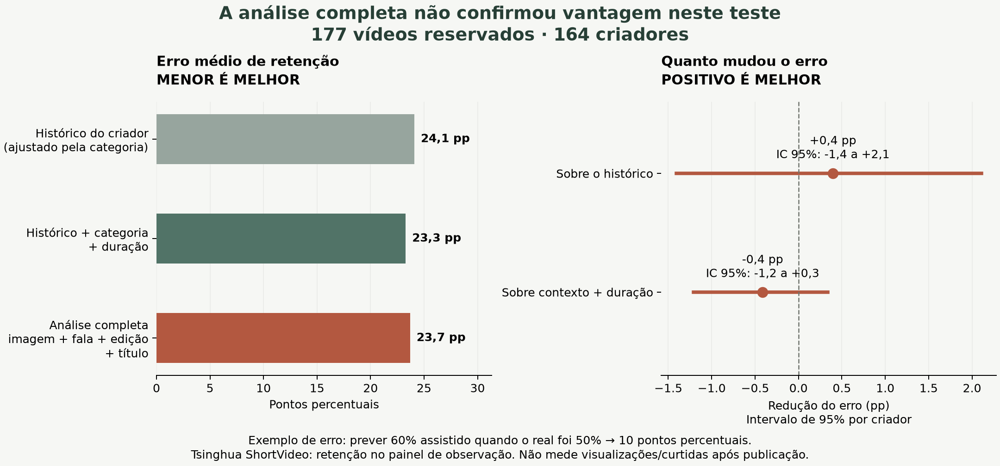
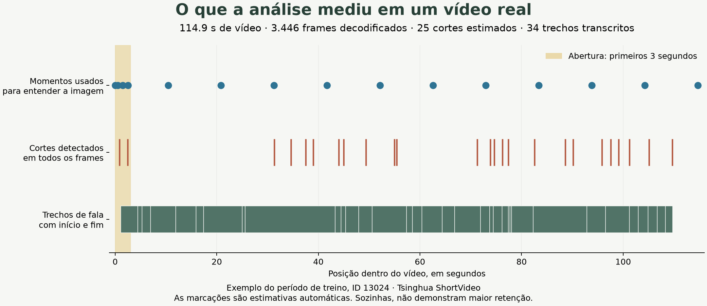

# Imagem, fala e edição ajudam a superar o histórico?

**Não demonstramos uma vantagem confiável desta análise de imagem, fala e edição sobre o histórico.** O resultado abaixo separa a comparação com o histórico da comparação mais difícil, que também conhece categoria e duração. O critério de sucesso definido antes do teste não foi cumprido.

Em **177 vídeos reservados, de 164 criadores**, o erro médio foi **24,1 pontos percentuais** usando o histórico ajustado, **23,3** usando também categoria/duração e **23,7** com a análise completa.

Somente **27,7%** das previsões completas ficaram a até dez pontos percentuais do valor observado. Esse percentual mede uma tolerância explícita, não “acurácia geral” nem acerto exato.

## O que estamos prevendo

**Quanto do vídeo as pessoas assistem.** Se alguém assiste 30 segundos de um vídeo de 60 segundos, a retenção é 50%. O alvo é a média dessa fração nas observações das primeiras 24 horas desde que o vídeo aparece no painel. Repetições são limitadas a 100%.

Um erro de 10 pontos percentuais seria prever 60% assistido quando o observado foi 50%. **Menor erro é melhor.** Reduzir o erro em 10% não significa aumentar em 10% a retenção do vídeo.

A base pública oferece os arquivos completos, criadores e tempos de visualização. Ela não oferece a data de publicação necessária para validar visualizações/curtidas sete dias depois. A primeira aparição no painel não é um lançamento. Este é um estudo adicional de retenção; os [testes anteriores de metadados](REAL_DATA_RESULTS.md) mantêm seus resultados e limitações.

## O trabalho executado

| Evidência | Quantidade |
|---|---:|
| Interações auditadas na fonte | 794.053 |
| Arquivos de vídeo baixados | 954 |
| Vídeos íntegros aceitos | 945 |
| Horas de vídeo | 13,81 |
| Frames decodificados pelo detector de edição | 1.984.272 |
| Imagens usadas pelo encoder visual | 14.173 |
| Vídeos com fala transcrita | 869 |
| Trechos de fala com tempos | 19.761 |
| Falhas de download / extração | 0 / 9 |
| Duplicatas exatas removidas | 0 |
| Vídeos no treino final / teste reservado | 623 / 177 |

Outros 145 vídeos elegíveis ficaram fora do treino/teste final por atravessar o intervalo de segurança temporal. Seus resultados ainda não estariam completos no momento de treinar o modelo final. As duas janelas anteriores serviram para escolher configurações; não foi feito sorteio aleatório para misturar passado e futuro.

As exclusões estão detalhadas na [auditoria dos arquivos](results/multimodal/extraction-audit.json), com ID, motivo e durações. Na execução registrada, oito arquivos divergiam dos tempos dos logs e um estava fisicamente incompleto. A nova tentativa de baixar esse último trouxe o mesmo conteúdo e o mesmo hash. A investigação e as exclusões aconteceram antes do treinamento; os arquivos originais foram preservados localmente.

Usamos **OpenCLIP** para imagem, **Whisper Large v3 Turbo** para fala, um encoder semântico multilíngue para título/transcrição e **PySceneDetect com fluxo óptico** para cortes e movimento. O detector de edição decodifica todos os frames; a compreensão semântica da imagem usa amostras distribuídas, incluindo a abertura. Os modelos foram executados localmente, com versões e hashes registrados.

## Comparação nos mesmos vídeos

| Entrada da previsão | Erro médio por vídeo ↓ | Erro equilibrado por criador ↓ | Erro até 10 pp ↑ |
|---|---:|---:|---:|
| Média histórica do criador | 25,17 pp | 25,33 pp | 29,4% |
| Histórico ajustado pela categoria | 24,10 pp | 24,21 pp | 28,2% |
| Histórico + categoria + duração | 23,29 pp | 23,16 pp | 26,6% |
| Contexto + título | 23,37 pp | 23,15 pp | 27,1% |
| Contexto + imagem | 23,78 pp | 23,63 pp | 25,4% |
| Contexto + fala/som | 23,41 pp | 23,17 pp | 26,6% |
| Contexto + edição | 23,23 pp | 23,10 pp | 28,2% |
| Contexto + título + imagem + fala/som + edição | 23,70 pp | 23,50 pp | 27,7% |

“Contexto” significa o histórico disponível do criador e da categoria, sua variabilidade, quantidade de observações e duração. Cada combinação escolheu sua configuração usando somente o desenvolvimento. O modelo completo foi escolhido como **catboost_5**; a referência de contexto, **catboost_3**. Os seis modelos não usam resultados do próprio vídeo como entrada.

As linhas mostram se cada modalidade acrescenta valor à mesma referência. Não são efeitos causais: a tabela não permite prometer que inserir um corte ou trocar uma frase aumentará a retenção. Também não escolhemos outro vencedor após olhar o teste.

## A diferença é convincente?

Abaixo, um número positivo significa que a análise completa errou menos. O intervalo de 95% reamostra criadores e preserva a comparação entre previsões do mesmo vídeo.

| Referência comparada à análise completa | Redução do erro | Intervalo de 95% | Redução relativa do erro |
|---|---:|---:|---:|
| Histórico ajustado pela categoria | 0,40 pp | -1,41 a 2,11 pp | 1,6% |
| Histórico + categoria + duração | -0,41 pp | -1,21 a 0,34 pp | -1,8% |
| Contexto + título | -0,33 pp | -1,07 a 0,39 pp | -1,4% |

O critério registrado exigia reduzir o erro em pelo menos 5% contra **histórico ajustado e contexto**, com limite inferior positivo nos dois intervalos, além de pelo menos cem vídeos e cinquenta criadores. **Critério cumprido: não.** Os intervalos medem a incerteza do ganho médio, não uma garantia para cada vídeo.

Ordenação entre vídeos do mesmo criador: **58,3% em 12 pares**, considerando somente pares com pelo menos cinco pontos de diferença real. A quantidade de pares limita essa leitura; não substitui a métrica principal.

## Cinco exemplos sem escolher pelos acertos

São os primeiros cinco vídeos do teste em ordem cronológica. Os valores são retenção média, não contagem de visualizações.

| Vídeo | Observado | Histórico ajustado | Análise completa | Erro da análise |
|---|---:|---:|---:|---:|
| 61912 | 43,6% | 66,2% | 61,8% | 18,3 pp |
| 62797 | 53,9% | 64,2% | 52,5% | 1,4 pp |
| 9653 | 52,4% | 47,2% | 45,6% | 6,8 pp |
| 71193 | 54,1% | 21,0% | 49,7% | 4,5 pp |
| 33129 | 100,0% | 66,0% | 60,6% | 39,4 pp |

Todas as previsões estão no [arquivo do teste](results/multimodal/test_predictions.csv). Ele permite conferir as médias, os erros individuais e os exemplos, inclusive os desfavoráveis.

## O que esta evidência ainda não resolve

- É uma semana de recomendações observadas em um painel na China, em setembro de 2022. A população não representa campanhas brasileiras nem todos os vídeos publicados.
- A amostra exige histórico e dez observações do vídeo. Não comprova desempenho para novos criadores ou vídeos com pouca exposição.
- Os arquivos são reais, mas não há garantia de que títulos e arquivos sejam versões preservadas antes da publicação. Republicações modificadas podem escapar da deduplicação.
- A transcrição e os cortes são automáticos. Sua precisão contra anotações humanas não foi medida. Maior modelo de fala não equivale a maior precisão comprovada.
- Usuários e recomendações podem gerar dependências além do criador. O bootstrap não remove seleção de audiência nem permite inferir causalidade.
- Nenhum resultado promove automaticamente o modelo a produção. O próximo teste decisivo exige arquivos originais, contexto e previsões registrados antes de publicar, com resultados medidos no horizonte do case.

## Conferir e reproduzir

O [método e os comandos](FULL_VIDEO_METHOD.md) explicam aquisição, extratores, partições e execução. O teste final já foi aberto uma vez; o workspace impede reutilizá-lo para ajustar configurações. Reproduzir esta execução não constitui um segundo teste independente.

Arquivos auditáveis: [protocolo anterior ao teste](results/multimodal/protocol.json), [aquisição](results/multimodal/acquisition.json), [auditoria da extração](results/multimodal/extraction-audit.json), [plano com hashes e IDs](results/multimodal/plan.json), [desenvolvimento](results/multimodal/development.json), [escolha congelada](results/multimodal/selection.json) e [resultado final](results/multimodal/final.json). Os arquivos completos e os modelos treinados permanecem em `.runtime/`, fora do Git.

Fonte primária: [Tsinghua ShortVideo Dataset](https://github.com/tsinghua-fib-lab/ShortVideo_dataset), descrito na [publicação WWW 2025](https://arxiv.org/html/2502.05922v1). A extração de atributos foi implementada no repositório; nenhum resultado sintético foi apresentado como evidência deste teste.
