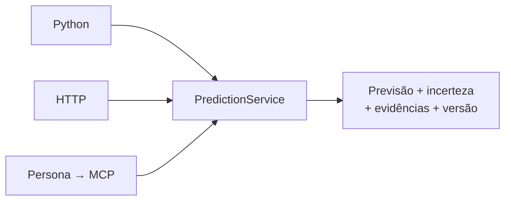

# Uma ferramenta, três interfaces



## Python

```python
import json
from pathlib import Path
from galaxies.schemas import PredictRequest
from galaxies.service import predict

request = PredictRequest.model_validate(json.loads(Path("examples/predict.json").read_text()))
result = predict(request.creative, request.context)
print(result.model_dump(mode="json"))
```

Use uma instância persistente de `PredictionService` para chamadas frequentes: ela reutiliza o modelo carregado. Todos os criativos de `CompareRequest` compartilham o mesmo contexto. Defina `model_id` para fixar uma versão; omita para usar a ativa.

## HTTP

```bash
uv run galaxies serve
curl http://127.0.0.1:8000/api/compare \
  -H 'Content-Type: application/json' \
  --data-binary @examples/compare.json
```

| Operação | Endpoint |
|---|---|
| Estado | `GET /api/status` |
| Prever | `POST /api/predict` |
| Comparar | `POST /api/compare` |
| Importar dataset | `POST /api/datasets` (multipart) |
| Auditar dataset | `GET /api/datasets/{name}/audit` |
| Treinar | `POST /api/train` |
| Consultar execução | `GET /api/jobs/{id}` |
| Reiniciar execução interrompida | `POST /api/jobs/{id}/retry` |
| Consultar modelo | `GET /api/models/{id}` |
| Ativar modelo | `POST /api/models/{id}/promote` |
| Enviar vídeo | `POST /api/media` (multipart) |
| Extrair atributos | `POST /api/media/{id}/extract` |
| Inspecionar rastro | `GET /api/traces/{id}` |
| Registrar previsão futura | `POST /api/prospective` |
| Adicionar resultado | `POST /api/prospective/{id}/outcome` |
| Avaliação prospectiva | `GET /api/prospective` |

O OpenAPI fica em `/openapi.json` e a documentação interativa em `/docs`. O workbench não usa serviços externos; a página Swagger padrão carrega seus assets do CDN público jsDelivr.

### Treinamento assíncrono

```json
{"dataset":"cliente-v1.jsonl","config":{"iterations":240,"coverage":0.9,"seed":42}}
```

O servidor retorna HTTP 202 com o ID. Estados: `queued → running → completed`, ou `failed`/`interrupted`. O resultado contém o relatório e a versão criada. Treinar não ativa automaticamente a versão.

### Contrato de saída

| Campo | Como a persona deve usar |
|---|---|
| `predicted_metric` | Estimativa, identificada como tal |
| `interval_low`, `interval_high`, `nominal_coverage` | Faixa de predição e cobertura nominal |
| `confidence_flag`, `confidence_reasons` | Limitações que precisam acompanhar a resposta |
| `evidence_level` | Distinguir demonstração sintética de avaliação retrospectiva |
| `eligible_for_decision` | Impedir recomendações quando falso |
| `top_drivers` | Contribuições SHAP em log; não interpretar como efeitos causais |
| `comparables`, `extraction_evidence` | Referências e trechos verificáveis |
| `model_id`, `trace_id` | Auditoria e reprodução |

Na comparação, observe `decision`: `demonstration_only`, `insufficient_evidence`, `technical_tie` ou `recommendation`. `recommended_id` fica nulo nos três primeiros casos. Não transforme o primeiro lugar de um ranking ilustrativo em recomendação de campanha.

## MCP

Servidor stdio com o SDK oficial, fixado na linha 1.x no lockfile:

```bash
uv run galaxies mcp
```

Veja [examples/mcp.json](../examples/mcp.json). Substitua o caminho absoluto pela localização do repositório. Se o cliente usar outro diretório de trabalho, configure `GALAXIES_WORKSPACE` com o caminho absoluto da mesma `.runtime` utilizada pela API.

Ferramentas: `predict_creative`, `compare_creatives`, `train_model`, `get_training_status`, `get_model_report` e `list_models`. As saídas usam `structuredContent`; o stdout é reservado ao protocolo. A ativação do modelo fica no CLI/API, sem uma tool de promoção automática à disposição da persona.

Não foi realizada conexão com a plataforma interna da Galaxies. O teste de integração executa um cliente MCP real contra o processo local, lista ferramentas e consome uma saída estruturada.

## Validação prospectiva

Em `POST /api/prospective`, envie `PredictRequest` com `as_of` atual (tolerância de cinco minutos), publicação futura e atributos observados. Modelos/entradas sintéticas são recusados. Guarde o ID retornado.

No horizonte, envie:

```json
{"target":1200,"published_at":"2026-10-10T18:00:00Z","observed_at":"2026-10-17T18:10:00Z"}
```

As datas são ilustrativas. O endpoint valida publicação posterior ao registro, observação já ocorrida e janela do horizonte. O resultado é append-only. Desvios de horário são registrados; alterações no próprio conteúdo exigem um novo registro pré-publicação.
