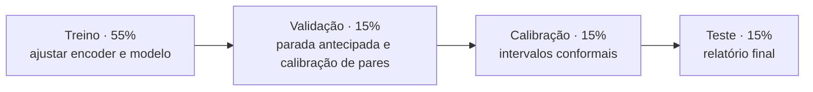

# Como saber se o modelo ajuda

**Unidade de decisão:** escolher entre criativos para o mesmo canal, setor, horizonte e contexto. Dados observacionais permitem avaliar capacidade preditiva; não provam aumento causal de resultado.

## 1. Alvo e referências

O preditor central minimiza erro em `log(1 + contagem)`. A inversão por `expm1` produz uma estimativa central nessa escala; não se deve interpretá-la automaticamente como média aritmética da contagem.

O alvo padrão da demonstração é curtidas em sete dias. O contrato aceita outros horizontes de 1 a 90 dias, desde que cada modelo use um perfil único.

Baselines: média e mediana das últimas 20 publicações do canal com resultados já conhecidos. Sem histórico, usa-se a mediana do setor disponível naquele instante. As features de contexto também incluem uma mediana regularizada que combina canal e setor com peso `n / (n + 5)`.

## 2. Partição temporal



As proporções determinam cortes por datas distintas de publicação, não sorteio de linhas. Alvos que amadurecem após o próximo corte são expurgados. Portanto, as contagens finais não precisam refletir exatamente essas porcentagens.

PCA visual e SVD de texto são ajustadas só no treino. Duplicatas exatas são removidas; grupos de campanha são mantidos apenas na primeira partição em que aparecem. A lista de IDs e os cortes ficam nos artefatos.

O histórico é consultado ponto a ponto: publicar antes do alvo não basta; o resultado também precisa ter sido observado antes da decisão. No backtest, contexto pode incorporar resultados anteriores já conhecidos durante o período de teste, sem retreinar pesos.

## 3. O que cada métrica responde

| Métrica | Pergunta |
|---|---|
| MAE em log | Quanto erra em uma escala menos dominada por virais? |
| MAE | Qual o erro absoluto em unidades da métrica? |
| MAPE em alvos positivos | Qual o erro relativo? Quantos zeros ficaram de fora? |
| Spearman intra-canal | Ordena conteúdos dentro do mesmo canal? |
| Acerto par a par | Qual fração dos pares históricos tem a ordem correta? |
| Arrependimento de seleção | Quanto o escolhido ficou abaixo do melhor resultado observado no grupo? |
| Cobertura e largura | Quantos resultados cabem no intervalo e quão informativo ele é? |
| Macro F1 de faixas | Distingue desempenho abaixo, típico, acima e excepcional? |
| Brier de pares | As probabilidades de comparação têm boa qualidade probabilística? |

Pares e grupos de escolha usam o mesmo canal e janelas fixas de 14 dias. Empates verdadeiros são excluídos do acerto par a par; empate previsto vale 0,5. Janelas históricas ainda diferem de criativos randomizados em uma campanha real.

As faixas relativas usam limites fixos 0,75×, 1,25× e 3× a referência do canal. “Excepcional” é relativo; não é uma definição universal de viralidade.

## 4. Intervalos e probabilidades

O CatBoost MultiQuantile estima limites inferior e superior em log. As estimativas são ordenadas e abrangem a previsão central. Na partição de calibração, calcula-se `score = max(limite_inferior - y, y - limite_superior)`. O ajuste usa a ordem `ceil((n + 1) × cobertura)`; amostras insuficientes são rejeitadas. Ajustes negativos são limitados a zero, evitando estreitamento adicional.

Isso não elimina dependência temporal ou mudança de distribuição. A cobertura reportada é empírica; uma cobertura global adequada pode esconder falhas por setor. A largura do intervalo deve sempre acompanhar a cobertura.

A probabilidade de A superar B usa calibração logística simétrica com inclinação não negativa, ajustada **na validação**, em diferenças de previsões em log. Precisa de pelo menos 30 pares e cinco canais. A avaliação probabilística ocorre depois no teste. O limiar operacional de recomendação é 65%; não é uma meta de acurácia nem uma garantia universal. Ele deve ser reavaliado segundo o custo de erro na aplicação real.

## 5. Critérios de uso

Promoção real exige redução de MAE em log versus a mediana histórica, limite inferior positivo do bootstrap pareado de diferença de acerto, cobertura de pelo menos a nominal menos cinco pontos percentuais e cinco canais de teste. São critérios mínimos de pesquisa, não certificação de utilidade comercial.

O bootstrap reamostra diferenças médias por canal (1.000 amostras, seed fixa), preservando pares dependentes dentro dos canais. Ele não corrige toda dependência entre canais ou eventos comuns. A incerteza temporal precisa de avaliação adicional em produção.

Na inferência, o sistema abstém-se diante de modelo sintético, entradas simuladas, poucos resultados do canal, setor/idioma/regime não vistos, atributos fora da faixa ou maioria dos atributos ausentes. As estimativas continuam disponíveis com limitações explícitas.

## 6. Experimentos sem consumir o teste final

```bash
uv run galaxies experiments .runtime/datasets/demo.jsonl
```

A suíte reserva a última janela temporal de 15% do dataset original. Só observações já maduras antes desse corte entram no desenvolvimento. Dentro dessa base reduzida, executa ablações, modelos por setor, canais excluídos, Ridge e CatBoostRanker. Esses resultados são **avaliação de desenvolvimento**, com uma lista explícita de IDs finais preservados.

A arquitetura de ranking gera scores de ordenação, não contagens ou probabilidades. Especialistas só são comparáveis ao modelo global no mesmo setor e conjunto de IDs; compare resultados por setor, não um especialista contra a média global.

Escolha configurações no desenvolvimento, registre essa escolha e só depois execute o treino final. Repetir escolhas olhando o teste final invalida seu papel como confirmação independente.

## 7. Próxima evidência: publicação real

Receba arquivos autorizados antes de publicar; registre previsão, contexto e versão; observe o alvo no horizonte. O registro prospectivo rejeita demonstrações sintéticas e não permite sobrescrever resultados. Mudanças de horário são registradas.

Um teste prospectivo continua observacional. Demonstrar ganho de campanha requer desenho controlado, com condições comparáveis de distribuição. Não converta correlação ou ranking em promessas de ROI, CTR ou CAC.

## Referências

- [SMTPD, CVPR 2025](https://openaccess.thecvf.com/content/CVPR2025/html/Xu_SMTPD_A_New_Benchmark_for_Temporal_Prediction_of_Social_Media_CVPR_2025_paper.html): alinhamento temporal e importância da popularidade inicial. Este projeto não usa popularidade inicial do criativo como entrada.
- [Understanding Virality](https://arxiv.org/abs/2512.21402): atributos multimodais interpretáveis; seu alvo e protocolo não equivalem automaticamente aos deste projeto.
- [CatBoost SHAP](https://catboost.ai/docs/en/concepts/shap-values): contribuições aditivas do modelo, sem interpretação causal automática.
- [MAPIE](https://mapie.readthedocs.io/en/stable/): referência de incerteza conformal. A implementação aqui usa explicitamente o quantil de calibração separado, sem dependência desse pacote.
