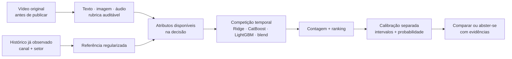
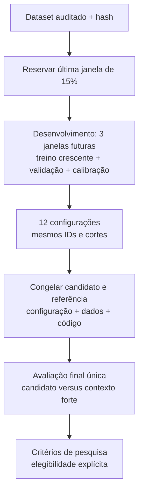
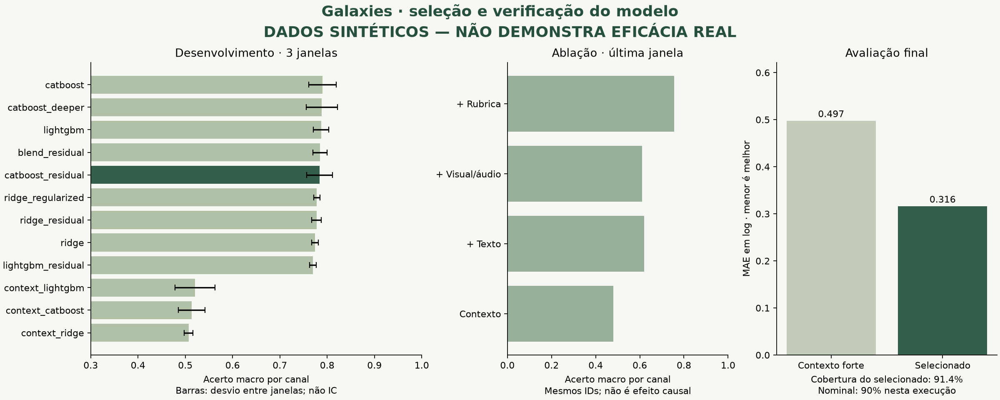

# O case está no modelo e na evidência

> **Estado em 18/10/2026:** existem avaliações com dados reais. A mais recente, [SMTPD](SMTPD_RESULTS.md), testou **515 vídeos de 165 canais** e não confirmou vantagem sobre histórico e contexto. O ganho modesto observado em 2016 não se generalizou nos estudos posteriores. Não há modelo promovido para produção. O trabalho e o piloto de coleta estão interrompidos; consulte [CURRENT_STATE.md](CURRENT_STATE.md).

## Evidência atual: real, sintética e ainda ausente

| Evidência | O que foi executado | Conclusão permitida |
|---|---|---|
| **SMTPD: views nominais em sete dias** | 8.112 vídeos com metadados utilizáveis; teste reservado de 515 vídeos/165 canais; datas e identidades recuperadas pela API oficial | Erro 0,18% menor que histórico e 0,03% maior que contexto; ganho não confirmado |
| **SMTPD: conteúdo do vídeo** | 669 mídias previstas, 667 baixadas, 662 extrações válidas; comparação multimodal em 219 vídeos completos do teste | Imagem, fala e edição juntas tiveram erro 0,5% maior que a referência textual; sem ganho confirmado |
| **Outras bases reais** | Metadados, retenção com vídeos completos, alcance de 2016, transferência e adaptação recente | Evidência específica de cada população/alvo; não somar amostras nem transferir conclusões entre estudos |
| **Protocolo sintético histórico** | 2.400 posts artificiais, 12 configurações, três janelas; resultados preservados abaixo | Verifica implementação; os 77,2% de ordenação não são desempenho em vídeos reais |
| **Rubrica VLM** | Adaptador opcional disponível no extrator básico | Não há validação humana cega nem ganho preditivo real demonstrado da rubrica |
| **Campanhas atuais e canal novo** | Não há confirmação prospectiva nem histórico do próprio usuário integrado à experiência atual | Não estimar views de um canal desconhecido usando outro canal como substituto |

Artefatos auditáveis: [515 previsões individuais](results/smtpd/final/test_predictions.csv), [seleção congelada](results/smtpd/final/selection.json), [verificação independente](results/smtpd/final/verification.json) e [auditoria de mídia](results/smtpd/final/media-audit.json).

## O que a ferramenta entrega agora

A interface separa **Meu vídeo** (descrição de fala, edição e medidas visuais, sem views) de **Canais da base** (reprodução de previsões históricas com comparação ao resultado observado). O adaptador `real_service` carrega os modelos SMTPD salvos para Python, HTTP e MCP, sem novo ajuste. [Guia da demonstração real](REAL_DEMO.md).

Na SMTPD, a previsão combina referências históricas, contexto e título; a correção multimodal escolhida no desenvolvimento usa **edição**, com alternativa textual para mídia ausente. O modelo de ordenação foi selecionado separadamente. O intervalo nominal de 90% cobriu 88,9% no teste. Não há probabilidade de viralização validada nem recomendação de investimento. SHAP e contribuições lineares explicam o cálculo, não efeitos causais de uma edição.

## Arquitetura e protocolo históricos do núcleo genérico

Os diagramas, as 12 configurações e as três janelas descritos nesta seção pertencem ao núcleo genérico e à execução sintética histórica; **não são o protocolo SMTPD**. Para os cortes e candidatos efetivamente usados na SMTPD, leia [SMTPD_PROTOCOL.md](SMTPD_PROTOCOL.md). A presença de uma rubrica no desenho abaixo não significa que ela tenha sido validada no estudo real.

A proposta técnica é combinar conteúdo multimodal com contexto disponível antes da publicação, estimar desempenho em um horizonte fixo e comparar criativos sob o mesmo contexto. A família vencedora precisa ser escolhida por avaliação temporal, não por preferência por uma arquitetura.

## Como a previsão é construída



Há duas formulações concorrentes. Na absoluta, o modelo estima `log(1 + alvo)`. Na residual, estima a diferença para `log(1 + mediana regularizada do canal)` e soma essa referência na inferência. Isso oferece ao modelo a hipótese de aprender desempenho relativo ao histórico, sem tratar diferenças de alcance como se fossem apenas qualidade criativa. Não identifica um efeito causal do conteúdo.

O contexto inclui estatísticas recentes, média móvel em log com decaimento temporal, tendência, idade do histórico, tamanho do canal, setor e regime de distribuição. Resultados que ainda não eram conhecidos são excluídos de cada consulta. Pesos de treino e métricas macro equilibram a participação dos canais.

**O nível dos extratores varia por estudo:** o núcleo anterior usa hashing + SVD e atributos descritivos de vídeo/áudio. O novo [pipeline de vídeo completo](FULL_VIDEO_METHOD.md) executa OpenCLIP, Whisper Large v3 Turbo, encoder semântico multilíngue e detector de cortes em todos os frames. Sua avaliação de retenção é separada da previsão de contagens. A precisão da transcrição e dos cortes ainda requer anotação humana cega; executar os encoders não comprova, por si só, ganho preditivo. Consulte [Multimodal](MULTIMODAL.md) para escolher o comando adequado.

## O protocolo que evita escolher pelo teste



1. **Comparação justa.** As 12 configurações usam os mesmos períodos, IDs e blocos permitidos. São três referências só de contexto, três Ridge, três CatBoost, dois LightGBM com conteúdo e um blend fixo CatBoost/Ridge. Modelos de quantis continuam usando CatBoost em todas as famílias.
2. **Seleção com dois objetivos.** Mantêm-se configurações até um erro padrão abaixo do melhor acerto macro; entre elas, excluem-se as com MAE macro em log mais de 10% acima do melhor. Depois se prefere menor complexidade, menor erro e melhor interval score. O mesmo procedimento escolhe a referência só de contexto. O erro padrão entre janelas é uma heurística; a dependência temporal impede interpretá-lo como garantia estatística.
3. **Calibração isolada.** A validação controla parada antecipada. Outra partição calibra intervalos e probabilidades de comparação; os alvos de teste não participam. Setores com pelo menos 40 exemplos de calibração recebem correção própria; os demais usam a global.
4. **Diagnósticos que podem falhar.** Ablações nos mesmos IDs, três seeds adicionais, três embaralhamentos do conteúdo de treino dentro de cada canal e exclusão de canais por setor. Os três embaralhamentos são um controle de sanidade, não um teste de permutação com p-valor confiável.
5. **Teste final registrado.** `selection.json` fixa os dois candidatos antes do teste. Hashes detectam mudanças nos dados, no código de modelagem e nas bibliotecas principais. Um registro exclusivo impede repetir a avaliação final do mesmo dataset nesse workspace. É uma proteção de auditoria, não uma defesa contra adulteração deliberada.

Um treino isolado continua útil para exploração, mas **não habilita promoção para uso real**. Essa elegibilidade exige o fluxo `research → final-evaluation`, ganho versus referências, cobertura global e por setor e amostra mínima. A confirmação final testa uma escolha congelada; não procura novamente o melhor modelo.

## Registro histórico da execução sintética (não representa todo o projeto)



Base: **2.400 posts artificiais, 24 canais, três setores**, seed do gerador `20261006`. Treinamento com seed `42`, até 180 iterações por modelo de árvores e três janelas de desenvolvimento. O processo gerador contém relações explícitas entre atributos e alvo; recuperá-las não prova que essas relações existam em vídeos reais.

| Configuração | Acerto macro no desenvolvimento | MAE macro em log |
|---|---:|---:|
| CatBoost absoluto | 79,0% | 0,331 |
| CatBoost mais profundo | 78,8% | 0,333 |
| LightGBM absoluto | 78,7% | 0,335 |
| Blend residual | 78,5% | 0,349 |
| **CatBoost residual — selecionado** | **78,4%** | **0,329** |
| Ridge mais regularizado | 77,8% | 0,442 |
| Ridge residual | 77,8% | 0,423 |
| Ridge absoluto | 77,4% | 0,410 |
| LightGBM residual | 77,0% | 0,340 |
| **Contexto LightGBM — referência** | **52,1%** | **0,493** |
| Contexto CatBoost | 51,3% | 0,493 |
| Contexto Ridge | 50,7% | 0,563 |

O vencedor não precisa liderar uma coluna isolada: o CatBoost residual ficou dentro da margem de ranking e teve menor erro macro entre os candidatos elegíveis de mesma complexidade. A regra foi fixada antes de abrir o teste desta base.

### A janela final responde outra pergunta

Nos **360 exemplos e 622 pares** finais, o candidato congelado foi comparado à referência congelada:

| Métrica final | CatBoost residual | Contexto LightGBM |
|---|---:|---:|
| Acerto entre pares | 77,2% | 46,3% |
| MAE em log | 0,316 | 0,497 |
| MAE em curtidas | 313,9 | 454,8 |
| Cobertura do intervalo nominal de 90% | 91,4% | 90,8% |
| Largura média, em curtidas | 1.385,2 | 1.868,0 |
| Interval score em log, menor é melhor | 1,843 | 2,504 |

O ganho macro de acerto foi 30,9 pontos percentuais, com intervalo bootstrap por canal de 24,8 a 36,7 pontos. Essa incerteza descreve a amostra artificial e não a eficácia no mundo real. A cobertura por setor foi 90,8% em automotivo, 89,2% em beleza e 94,2% em moda, 120 exemplos por setor. A versão permanece `eligible_for_decision: false` por sua origem sintética.

**77,2% é acerto de ordenação entre pares, não “77,2% de precisão na quantidade de curtidas”.** Para contagens, leia os erros; para intervalos, leia cobertura, largura e penalidade por resultados fora da faixa.

### O que os diagnósticos revelaram

| Diagnóstico no desenvolvimento | Resultado | Interpretação permitida |
|---|---|---|
| Só contexto → + texto → + visual/áudio → + rubrica | 48,1% → 61,9% → 61,0% → 75,6% de acerto | Mais modalidades não garantem ganho; a rubrica domina neste gerador |
| Conteúdo de treino embaralhado dentro do canal | 45,5%, 53,0%, 47,9% | Destruir a associação conteúdo/alvo reduz o sinal artificial |
| Seeds de treino adicionais | 75,9%, 73,8%, 75,6% | Há variação; a seed mais favorável não foi escolhida |
| Canais totalmente excluídos do histórico/treino | 60 exemplos; MAE log 2,549; **0% de cobertura** | A contagem e a incerteza falham gravemente nessa coorte |

O último resultado é uma limitação importante. O acerto de ranking dessa coorte, 81,0%, não compensa contagens e intervalos inadequados. **O modelo não está validado para canais sem histórico; a regra de abstenção é necessária.** Melhorar esse cenário exige uma população real de novos canais e um modelo/calibração próprios de início de operação, avaliados separadamente. O agregado de canais vistos e novos esconderia esse problema.

## O que falta para defender excelência no modelo

| Evidência necessária | Como produzir | Situação |
|---|---|---|
| Rótulos corretos e representativos | Métrica no mesmo horizonte, origem e disponibilidade verificáveis, distribuição paga separada | SMTPD e outras fontes públicas avaliadas; falta base representativa com versões pré-publicação verificadas |
| Representação semântica útil | Comparar texto, frames/segmentos, áudio, embeddings e rubrica nos mesmos cortes; medir concordância humana e erros de extração | Imagem, fala e edição avaliadas em vídeos reais; sem ganho confirmado. Rubrica VLM e precisão dos extratores ainda sem auditoria humana cega |
| Valor além do histórico | Superar referências simples e contexto aprendido em erro e ordenação no futuro; reportar setores e canais | SMTPD: comparação explícita com histórico e contexto, sem confirmação; estudos anteriores preservados |
| Generalização para novos clientes | Canais/clientes excluídos e calibração dedicada; manter abstenção enquanto falhar | Diagnóstico implementado e falha registrada |
| Robustez a mudança temporal | Várias janelas e acompanhamento de cobertura/erro; política de recalibração | Teste público temporal executado; seleção instável e limitações de cobertura registradas |
| Utilidade antes da publicação | Registrar previsões e versão antes de publicar; avaliar resultados maduros | Registro prospectivo implementado; piloto novo interrompido com zero vídeos registrados, sem confirmação prospectiva |
| Melhoria efetiva de campanha | Experimento controlado com condições de distribuição comparáveis | Não executado |

Sem essas evidências, aumentar complexidade, trocar de LLM ou acrescentar um ensemble não permite afirmar “melhor solução possível”. A arquitetura oferece hipóteses comparáveis e rastreáveis; a escolha de produção deve seguir o resultado real, incluindo a possibilidade de um modelo mais simples vencer.

## Referência histórica de reprodução sintética — não executar nesta revisão

Os comandos abaixo geram dados e treinam modelos; não são necessários para consultar os resultados já publicados e não foram executados nesta atualização documental. O trabalho permanece interrompido.

No macOS, instale `brew install libomp ffmpeg`; no Ubuntu, `sudo apt-get install libgomp1 ffmpeg`. Em um workspace novo:

```bash
uv sync --frozen --group dev
uv run galaxies demo-data .runtime/datasets/research-validation-20261006.jsonl \
  --seed 20261006 --channels 24 --posts 100
uv run galaxies research .runtime/datasets/research-validation-20261006.jsonl \
  --iterations 180 --folds 3 --seed 42
# Use o research_id impresso acima; revise o desenvolvimento antes de abrir o teste.
uv run galaxies final-evaluation .runtime/datasets/research-validation-20261006.jsonl \
  .runtime/reports/RESEARCH_ID
```

`demo-data` recusa sobrescrever uma base existente. O teste final é de uso único por fingerprint no workspace: não apague seu registro para tentar melhorar o resultado. Uma falha após a abertura exige análise do estado e deve ser documentada; o sistema não presume que o teste continue não visto.

Artefatos desta execução: [plano](results/research/plan.json), [desenvolvimento completo](results/research/development.json), [seleção congelada](results/research/selection.json), [avaliação final](results/research/final.json) e [relatório do modelo](results/research/model-report.json). A figura é gerada por `scripts/render_research.py` a partir desses JSONs.

Durante a implementação, a base inicial de 2.160 exemplos foi usada para explorar modelos e corrigir o protocolo. Seu teste foi consultado sob uma regra anterior. A execução documentada aqui usa outra base artificial de seed fixada e a regra revisada, sem reutilizar aquele teste. Isso verifica o protocolo revisado; não cria evidência independente do processo gerador. Os resultados históricos do [demo inicial](DEMO.md) foram preservados e não devem ser comparados diretamente a estes como melhora ou regressão.

## Fundamentos

- [SMTPD, CVPR 2025](https://arxiv.org/abs/2503.04446) motiva atenção ao alinhamento temporal. Popularidade inicial do próprio vídeo pertence a outro problema; este projeto exige previsão pré-publicação.
- [Scikit-learn: validação cruzada](https://scikit-learn.org/stable/modules/cross_validation.html) documenta a necessidade de respeitar estrutura temporal e grupos. Aqui os cortes também expurgam rótulos imaturos.
- [Bracher et al.: avaliação de previsões por intervalos](https://arxiv.org/abs/2005.12881) fundamenta penalizar largura e falhas de cobertura. Implementamos interval score para um nível nominal; não uma avaliação WIS com múltiplos níveis.
- [CatBoost: SHAP](https://catboost.ai/docs/en/concepts/shap-values) descreve contribuições aditivas. Atribuições explicam o score bruto em log antes do piso de contagem, não efeitos causais de editar o vídeo.
