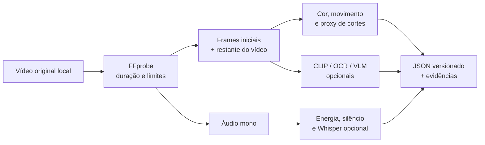

# Do vídeo aos atributos

## Estado atual — 18/10/2026

**Os extratores de imagem, fala e edição foram executados e avaliados em vídeos reais. Isso não demonstrou ganho preditivo consistente.** Há dois estudos distintos:

| Estudo | Dados e processamento | Resultado reservado |
|---|---|---|
| [SMTPD: views em sete dias](SMTPD_RESULTS.md) | 669 vídeos previstos, 667 baixados, 662 extrações válidas; falhas preservadas | 219 vídeos completos no recorte multimodal do teste; combinação completa com erro 0,5% maior que texto, sem confirmação de ganho |
| [Tsinghua: retenção](FULL_VIDEO_RESULTS.md) | 945 vídeos aceitos e processados; 177 no teste | Não confirmou ganho sobre o histórico; o alvo é retenção, não views |

A SMTPD transcreveu o áudio integralmente, decodificou todos os frames para detectar cortes e amostrou imagens para o encoder visual. Foram comparados texto de controle, imagem, fala, edição e combinação completa. A estratégia selecionada usa edição; as demais modalidades continuam documentadas, inclusive resultados negativos. Mídia ausente mantém a alternativa textual congelada na avaliação principal de 515 vídeos.

### O que está implementado não é o mesmo que o que está validado

| Componente | Estado da evidência |
|---|---|
| OpenCLIP, Whisper e detector de cortes | Executados em vídeos reais e incluídos nas comparações preditivas; não há auditoria humana cega suficiente para certificar a precisão dos atributos |
| Encoder semântico multilíngue | Usado nos estudos reais; distinto do hashing + SVD do núcleo sintético original |
| Rubrica VLM via Ollama | Adaptador opcional do extrator básico; **não validado como rubrica real nem como fonte de ganho preditivo** |
| OCR | Adaptador opcional; não apresentar como modalidade avaliada na comparação SMTPD |
| Interface “Meu vídeo” | Extração descritiva local, sem views, nota de qualidade ou inferência de produtos/emoções |
| Interface “Canais da base” | Inferência com modelos congelados e exemplos históricos; sem recomendação de produção |

A [interface real](REAL_DEMO.md) reutiliza pesos já instalados e caches verificados. Vídeo próprio não recebe o histórico de um canal emprestado. A rubrica VLM não é equivalente às representações do CLIP nem às medidas de edição. “Imagem e fala extraídas” não significa “imagem e fala melhoraram a previsão”.

O trabalho está interrompido. Os comandos abaixo são referências de implementação, alguns com instalação/download de pesos; **não foram executados nesta revisão e não são autorização para retomada**. [Estado e pendências](CURRENT_STATE.md).

## Pipeline completo: referência do estudo de retenção

O [estudo de vídeo completo](FULL_VIDEO_METHOD.md) tem um pipeline próprio: OpenCLIP para imagem, Whisper Large v3 Turbo para fala, encoder semântico multilíngue e detecção de cortes sobre todos os frames. Esse pipeline usa pesos fixados, cache por conteúdo e verificações de integridade antes de treinar.

O [resultado de retenção](FULL_VIDEO_RESULTS.md) já está disponível: 945 vídeos íntegros processados, 177 no teste final e nenhum ganho confiável confirmado sobre o histórico.

```bash
uv sync --frozen --group dev --extra audio --extra vision --extra semantic --extra apple
uv run --no-sync python scripts/run_multimodal.py weights --speech-backend mlx
uv run --no-sync python scripts/run_multimodal.py analyze /caminho/video.mp4 \
  --speech-backend mlx --output .runtime/analise-completa.json
```

Esse perfil usa Apple Silicon. A alternativa CPU e suas diferenças estão no método. O JSON mostra o conteúdo extraído; não atribui uma nota de viralidade. O estudo de retenção permanece separado do contrato de previsão de visualizações/curtidas.

As seções seguintes documentam o extrator básico da aplicação e seus adaptadores opcionais. O comando `galaxies extract` continua disponível, mas não executa automaticamente o pipeline do estudo acima.

## Extrator básico da aplicação



## Execução básica, local

```bash
uv run galaxies extract /caminho/video-autorizado.mp4
```

Requer FFmpeg. Extrai duração, luminosidade, saturação, variação entre frames, proxy de cortes, energia acústica e silêncio. Não baixa o vídeo. As imagens incluem abertura e amostras do restante da duração.

O proxy de cortes compara frames amostrados; não é um detector exato de todas as transições. Vídeos sem áudio continuam processáveis. Limites padrão: 100 MB, 180 segundos e resolução máxima de 4K.

## Módulos opcionais do extrator básico (não confundir com as modalidades do estudo SMTPD)

| Módulo | Instalação | Uso | Resultado |
|---|---|---|---|
| Whisper | `uv sync --extra audio` | `--audio` | Transcrição e densidade de fala |
| OpenCLIP | `uv sync --extra vision` | `--vision` | Embedding visual agregado dos frames |
| OCR | `uv sync --extra ocr` | `--ocr` | Contagem de palavras reconhecidas nos frames |
| VLM | Servidor Ollama com modelo visual | `--vlm` | Rubrica JSON com evidências temporais |

Para instalar vários, use `uv sync --extra audio --extra vision --extra ocr`. A primeira execução dos encoders pode baixar pesos dos respectivos projetos. Esses pesos, seus requisitos de hardware e suas licenças devem ser conferidos para o ambiente de uso. Não são baixados no fluxo básico nem nos testes padrão.

```bash
export GALAXIES_VLM_URL=http://127.0.0.1:11434
export GALAXIES_VLM_MODEL=qwen2.5vl:7b
uv run galaxies extract video.mp4 --audio --vision --ocr --vlm
```

O endpoint Ollama deve estar preparado pelo operador. Não é iniciado ou instalado automaticamente. A rubrica descreve abertura, presença do produto, demonstração, densidade de texto, ritmo, benefício e CTA. Uma nota de energia da fala gerada apenas com imagens/transcrição é descartada: essa entrada não sustenta uma inferência acústica confiável.

O extrator visual não estima “potencial viral”, curtidas ou views. Instruções dentro do vídeo/transcrição são tratadas como conteúdo, não comandos. O JSON tem schema rígido, atributos permitidos e timestamps limitados à duração real. Isso valida a estrutura; a veracidade das observações ainda exige auditoria humana.

## Processar uma base

```bash
uv run galaxies enrich base.jsonl /pasta/dos/videos base-enriquecida.jsonl --audio --vision --ocr --vlm
```

Cada registro precisa de `media_id`, resolvido dentro da pasta autorizada. O comando cria uma versão nova e preserva os tempos de disponibilidade declarados. Ele não consegue comprovar que um arquivo é idêntico ao original pré-publicação; essa evidência vem da proveniência.

Todas as linhas com embeddings devem usar o mesmo encoder. Trocar o encoder exige nova versão de features e novo treinamento; uma dimensão coincidente não prova compatibilidade semântica.

## Cache e reprodutibilidade

A chave combina hash do arquivo, versão do extrator, opções e nome do VLM. Ao trocar implementação ou pesos por trás do mesmo nome, incremente `EXTRACTOR_VERSION`; não reutilize o cache anterior. Configurações exatas de modelos opcionais precisam ser registradas junto ao experimento real.

## Auditoria humana da extração — pendente

Monte dois arquivos JSON com linhas no formato abaixo, um anotado por pessoas e outro pelo extrator:

```json
[{"creative_id":"video-01","features":{"hook_clarity":7,"demonstration":1,"cta":0}}]
```

```bash
uv run galaxies audit-extraction anotacao-humana.json extracao.json
```

O relatório mostra MAE por atributo e, para indicadores binários, concordância e kappa quando definidos. Selecione exemplos cegos de diferentes setores, durações e qualidades. Só depois meça se esses atributos ajudam a prever os resultados.
