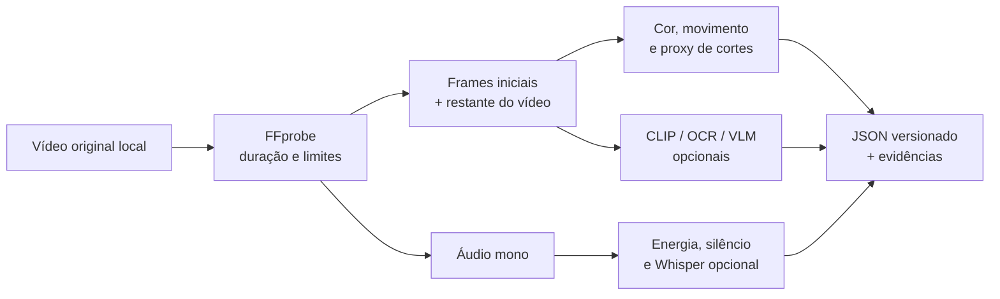

# Do vídeo aos atributos



## Execução básica, local

```bash
uv run galaxies extract /caminho/video-autorizado.mp4
```

Requer FFmpeg. Extrai duração, luminosidade, saturação, variação entre frames, proxy de cortes, energia acústica e silêncio. Não baixa o vídeo. As imagens incluem abertura e amostras do restante da duração.

O proxy de cortes compara frames amostrados; não é um detector exato de todas as transições. Vídeos sem áudio continuam processáveis. Limites padrão: 100 MB, 180 segundos e resolução máxima de 4K.

## Módulos opcionais

| Módulo | Instalação | Uso | Resultado |
|---|---|---|---|
| Whisper | `uv sync --extra audio` | `--audio` | Transcrição e densidade de fala |
| OpenCLIP | `uv sync --extra vision` | `--vision` | Embedding visual agregado dos frames |
| OCR | `uv sync --extra ocr` | `--ocr` | Contagem de palavras reconhecidas nos frames |
| VLM | Servidor Ollama com modelo visual | `--vlm` | Rubrica JSON com evidências temporais |

Para instalar vários, use `uv sync --extra audio --extra vision --extra ocr`. A primeira execução dos encoders pode baixar pesos dos respectivos projetos. Esses pesos, seus requisitos de hardware e suas licenças devem ser conferidos para o ambiente de uso. Não são baixados no fluxo básico nem nos testes padrão.

```bash
export GALAXIES_VLM_URL=http://127.0.0.1:11434
export GALAXIES_VLM_MODEL=qwen2.5vl:7b
uv run galaxies extract video.mp4 --audio --vision --ocr --vlm
```

O endpoint Ollama deve estar preparado pelo operador. Não é iniciado ou instalado automaticamente. A rubrica descreve abertura, presença do produto, demonstração, densidade de texto, ritmo, benefício e CTA. Uma nota de energia da fala gerada apenas com imagens/transcrição é descartada: essa entrada não sustenta uma inferência acústica confiável.

O extrator visual não estima “potencial viral”, curtidas ou views. Instruções dentro do vídeo/transcrição são tratadas como conteúdo, não comandos. O JSON tem schema rígido, atributos permitidos e timestamps limitados à duração real. Isso valida a estrutura; a veracidade das observações ainda exige auditoria humana.

## Processar uma base

```bash
uv run galaxies enrich base.jsonl /pasta/dos/videos base-enriquecida.jsonl --audio --vision --ocr --vlm
```

Cada registro precisa de `media_id`, resolvido dentro da pasta autorizada. O comando cria uma versão nova e preserva os tempos de disponibilidade declarados. Ele não consegue comprovar que um arquivo é idêntico ao original pré-publicação; essa evidência vem da proveniência.

Todas as linhas com embeddings devem usar o mesmo encoder. Trocar o encoder exige nova versão de features e novo treinamento; uma dimensão coincidente não prova compatibilidade semântica.

## Cache e reprodutibilidade

A chave combina hash do arquivo, versão do extrator, opções e nome do VLM. Ao trocar implementação ou pesos por trás do mesmo nome, incremente `EXTRACTOR_VERSION`; não reutilize o cache anterior. Configurações exatas de modelos opcionais precisam ser registradas junto ao experimento real.

## Auditar a extração

Monte dois arquivos JSON com linhas no formato abaixo, um anotado por pessoas e outro pelo extrator:

```json
[{"creative_id":"video-01","features":{"hook_clarity":7,"demonstration":1,"cta":0}}]
```

```bash
uv run galaxies audit-extraction anotacao-humana.json extracao.json
```

O relatório mostra MAE por atributo e, para indicadores binários, concordância e kappa quando definidos. Selecione exemplos cegos de diferentes setores, durações e qualidades. Só depois meça se esses atributos ajudam a prever os resultados.
