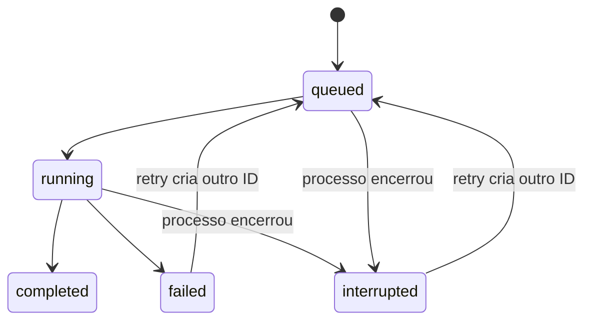

# Operar e evoluir

## Ambiente local

```bash
cp .env.example .env
uv run galaxies doctor
uv run galaxies serve
```

`.env` e `.runtime` estão fora do Git. O endereço padrão é loopback. Exposição fora de loopback exige `GALAXIES_API_TOKEN`; clientes usam `Authorization: Bearer ...`. O workbench guarda um token informado pelo usuário somente no `sessionStorage` da sessão.

O serviço é uma ferramenta local/de pesquisa de um único workspace. Não implementa contas, isolamento multi-tenant, cobrança ou gestão corporativa de identidade. Para disponibilização externa, acrescente HTTPS, proxy com limites de corpo/taxa, identidade corporativa, storage isolado e revisão operacional. Não exponha simplesmente a pasta de artefatos.

## Versões e recuperação



HTTP e MCP compartilham SQLite e respeitam um treino ativo por workspace. Jobs identificam o processo proprietário; processos vivos não são marcados como interrompidos por outra interface. O CLI de treino direto é uma operação administrativa e não participa dessa fila: evite executá-lo em paralelo a treinos pesados da API.

Uma execução interrompida é reiniciada do início. O cache de mídia é reaproveitado; o treinamento CatBoost não tem retomada parcial de árvores. Uma versão incompleta não aparece no registro até receber seu manifesto.

Ative versões de forma explícita. Para retornar a uma anterior, execute `galaxies promote ID_ANTERIOR` (ou `--demo` para uma demonstração). O registro guarda eventos de promoção com o ID anterior.

## Integridade

Todos os arquivos do bundle têm hashes SHA-256 verificados no carregamento. Projeções são salvas em JSON/NPZ com `allow_pickle=False`; modelos usam o formato CatBoost. O manifesto não é uma assinatura criptográfica de origem: importe apenas artefatos de origem confiável, já que um terceiro poderia alterar arquivo e manifesto juntos.

Faça backup consistente de `.runtime` e dos arquivos SQLite/WAL, preferencialmente com o serviço parado ou pelo mecanismo de backup do SQLite. A restauração precisa preservar datasets, encoder, modelo, relatório e manifesto correspondentes.

## Acompanhamento

```bash
uv run galaxies monitor
uv run galaxies prospective-report
```

O monitor resume até mil previsões persistidas: latência, evidência sintética/real, confiança e atributos ausentes. O relatório prospectivo acompanha erro e cobertura dos resultados recebidos. Os diagnósticos de faixa e ausência não são um teste estatístico completo de drift.

Observe falhas de extração, aumento de ausências, mudança de mix de setores, piora do erro e queda de cobertura. Investigue a causa e execute um novo experimento antes de promover outra versão. Retreino automático contínuo não está habilitado.

## MLflow opcional

```bash
uv sync --extra tracking
export MLFLOW_TRACKING_URI=file:./mlruns
uv run galaxies train minha-base.jsonl
```

Sem essa variável, os relatórios JSON e artefatos locais já registram experimentos. MLflow adiciona parâmetros, métricas e relatório; não é exigido pela demonstração.

## Limites conhecidos

- Os modelos opcionais de áudio/visão/VLM precisam ser provisionados e avaliados no hardware real.
- Snapshots do YouTube exigem chave e uso compatível; nenhuma coleta externa foi executada na implantação inicial.
- A detecção de domínio usa regras e faixas robustas de treino; não identifica todo tipo de mudança semântica.
- SQLite é adequado à instalação local; escalar equipes e clientes requer outra camada operacional.
- Rastros podem conter legendas/transcrições de clientes. Defina retenção e controle de acesso antes de usar conteúdo confidencial.
- Não há automação agendada de coleta, publicação, postagem, gasto ou contato com clientes.
