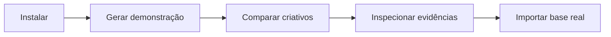

# Comece pelo fluxo completo

**Comece pela [demonstração real](REAL_DEMO.md) e pelo [resultado SMTPD](SMTPD_RESULTS.md).** Existem dados e modelos reais integrados. O teste reservado não confirmou ganho sobre histórico e contexto. O trabalho está interrompido; esta página é documentação de uso, não uma instrução para retomar experimentos.

## Uso atual, sem novo treino

Com o ambiente e os artefatos locais já preparados e o servidor ativo, abra [http://127.0.0.1:8000/](http://127.0.0.1:8000/):

- **Meu vídeo:** envie o arquivo para obter transcrição e medidas descritivas de edição/imagem, sem canal emprestado ou previsão de views.
- **Canais da base:** escolha uma publicação histórica e recalcule previsão, histórico, intervalo e resultado observado.

Para iniciar somente o servidor local, quando solicitado: `.venv/bin/galaxies serve`. Isso não treina nem coleta. A demonstração por comando é `scripts/demo_real.py`; os pesos e caches não acompanham um clone apenas do Git. Não execute `galaxies demo` para carregar os modelos SMTPD: esse comando gera dados e treina uma demonstração sintética.

## Fluxo sintético histórico e treinamento genérico (opcional, separado)

Os passos seguintes descrevem o núcleo genérico antigo. A interface correspondente está em `/synthetic`; não representa a avaliação real SMTPD.



## 1. Preparar

```bash
uv sync --frozen --group dev
uv run galaxies doctor
```

Para o LightGBM e processamento de vídeo no macOS: `brew install libomp ffmpeg`. Em Ubuntu: `sudo apt-get install libgomp1 ffmpeg`. A comparação de atributos pré-extraídos funciona sem FFmpeg.

## 2. Gerar dados e treinar

```bash
uv run galaxies demo
uv run galaxies serve
```

Abra [http://127.0.0.1:8000/synthetic](http://127.0.0.1:8000/synthetic). Cada execução de `demo` cria uma versão de modelo e ativa essa demonstração. As datas de 2025 são parte do cenário sintético fixo; não representam um teste prospectivo.

## 3. Explorar

| Tela | Experimente |
|---|---|
| Visão geral | Veja origem, volume e métricas do modelo |
| Comparar criativos | Analise os três cenários, abra evidências e exporte JSON |
| Modelos e evidências | Compare baseline, dispersão e cobertura por setor |
| Dados e treinamento | Inspecione uma base e crie uma versão em segundo plano |
| Como funciona | Entenda os conceitos e o estado da avaliação prospectiva |

Na demonstração, os controles de abertura e benefício alteram **atributos simulados**. Ao enviar um vídeo, esses controles são desabilitados e substituídos pelos atributos realmente extraídos. A extração básica não fabrica características semânticas ausentes.

## 4. Usar pelo terminal

```bash
uv run galaxies predict examples/predict.json
uv run galaxies compare examples/compare.json
uv run galaxies models
uv run galaxies experiments .runtime/datasets/demo.jsonl --iterations 120
```

Os exemplos são sintéticos. Os comandos usam o modelo ativo; a demonstração padrão é de curtidas em sete dias.

## 5. Introduzir uma base real

```bash
uv run galaxies validate minha-base.jsonl
uv run galaxies import-data minha-base.jsonl
uv run galaxies research minha-base.jsonl --iterations 180 --folds 3
# Inspecione a seleção congelada antes de consumir a janela final.
uv run galaxies final-evaluation minha-base.jsonl .runtime/reports/RESEARCH_ID
uv run galaxies promote MODEL_ID
```

`promote` verifica seleção congelada e critérios do relatório final. `train` continua disponível para exploração, mas não certifica um modelo real. Consulte o [protocolo completo](MODEL_CASE.md). Modelos sintéticos exigem `--demo` e nunca habilitam recomendações reais. Uma base deve conter uma única métrica/horizonte e origens sintéticas ou reais separadas.

Não substitua apenas `synthetic: true` por `false` no exemplo: isso não cria dados reais. Prepare o contrato a partir de observações autorizadas, com os tempos corretos. Veja [Dados](DATA.md).

## Resolução rápida

| Situação | Ação |
|---|---|
| Sem modelo ativo | Execute `uv run galaxies demo` ou treine e promova um modelo |
| Porta ocupada | `uv run galaxies serve --port 8001` |
| Sem FFmpeg | Instale FFmpeg; rode `galaxies doctor` |
| Modelo fora do horizonte | Selecione uma versão treinada para a mesma métrica e período |
| Histórico temporal insuficiente | Amplie a cobertura temporal da base; não force split aleatório |
| Atributos ausentes | Execute os extratores necessários ou forneça anotações verificadas |
| Treino interrompido | Use “Reiniciar” na tela de execuções; a versão incompleta não é promovida |
