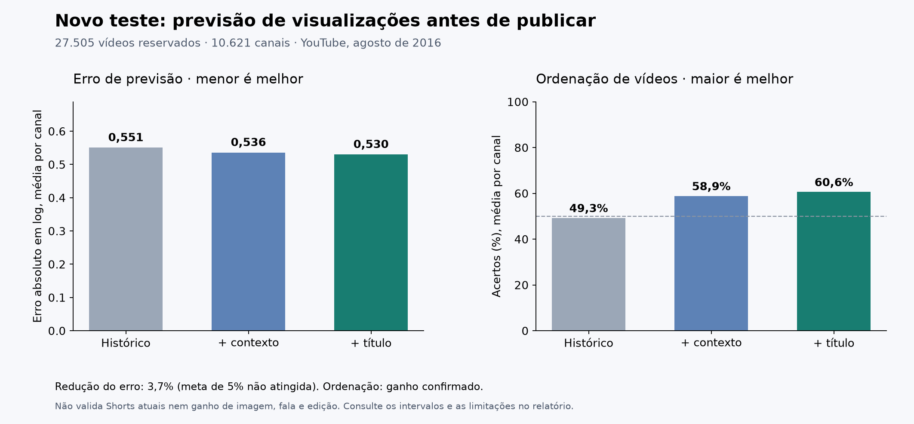

# O novo modelo supera o histórico?

**Houve uma redução de 3,7% no erro sobre o histórico, com intervalo de 95% positivo, mas abaixo do objetivo registrado de 5%.**

Foram avaliados **27.505 vídeos de 10.621 canais**, publicados de 20 a 31 de agosto de 2016 e reservados até o fim da seleção. São dados novos para esta avaliação, não publicações atuais.



## A comparação que importa

| Previsor | Erro médio em log por canal ↓ | Erro médio em visualizações ↓ | Entre metade e dobro do real ↑ | Acerto ao ordenar vídeos do mesmo canal ↑ |
|---|---:|---:|---:|---:|
| Histórico do canal | 0,551 | 7.764 | 71,6% | 49,3% |
| Histórico + contexto | 0,536 | 7.512 | 73,4% | 58,9% |
| Histórico + contexto + título **— escolhido antes do teste** | 0,530 | 7.492 | 73,8% | 60,6% |

O erro em log permite comparar canais de tamanhos diferentes; cada canal recebe o mesmo peso. A faixa de metade a dobro é ampla: prever de aproximadamente 500 a 2.000 para um resultado de 1.000 conta como dentro da faixa. Isso não é acurácia do número exato. A ordenação também dá peso igual aos canais, não a cada par.

O histórico escolhido foi `logmean_50`; contexto: `channel_context_mae4`; conteúdo: `channel_retrieval_mae4`. Essas escolhas foram feitas nas duas janelas de desenvolvimento, antes de abrir o teste.

## O ganho resiste à incerteza?

| Comparação | Redução relativa do erro | Intervalo de 95% da redução absoluta em log |
|---|---:|---:|
| Escolhido × histórico | 3,7% | [0,018; 0,023] |
| Conteúdo × histórico | 3,7% | [0,018; 0,023] |
| Conteúdo × contexto | 1,1% | [0,004; 0,007] |

Valores positivos significam menos erro. Um intervalo que inclui zero não estabelece superioridade. Os intervalos usam 5.000 reamostragens pareadas por canal; não são 5.000 experimentos independentes.

**Ganho adicional do conteúdo sobre histórico e contexto:** melhoria estatisticamente positiva, mas menor que o ganho relevante definido antes do teste. O critério exige redução de pelo menos 5% e intervalo inteiramente positivo contra as duas referências.

**Ordenação de vídeos do mesmo canal:** ganho confirmado neste recorte. Foram 34.598 pares, em 4.243 canais. Os pares não são independentes. A comparação exige intervalo positivo contra contexto e histórico.

Ganho de ordenação do conteúdo, em pontos percentuais: sobre histórico, **11,3**, IC95% [10,0; 12,6]; sobre contexto, **1,8**, IC95% [0,7; 2,8].

Os pares são vídeos publicados pelo mesmo canal na mesma semana de calendário. Podem ter datas e condições de distribuição diferentes; não são alternativas criativas testadas simultaneamente sob o mesmo orçamento.

## Cinco exemplos, sem escolher os melhores

São os cinco primeiros vídeos elegíveis do teste em ordem cronológica. Os números são visualizações na data de publicação e nas seis datas seguintes.

| ID do vídeo | Real | Histórico | Previsor escolhido |
|---|---:|---:|---:|
| `LiHujs43vbE` | 657 | 146 | 153 |
| `One76ZBtT7g` | 203 | 350 | 320 |
| `YAGLsEu1CeE` | 100 | 146 | 143 |
| `gndtT4lHdV8` | 470 | 511 | 403 |
| `1UIM34bMeaI` | 39.571 | 48.584 | 38.157 |

## Onde funciona e onde falha

| Recorte | Vídeos | Erro do histórico ↓ | Erro do conteúdo ↓ | Ganho do conteúdo sobre histórico |
|---|---:|---:|---:|---:|
| Automotivo | 8.453 | 0,624 | 0,597 | 4,3% |
| Howto & Style (categoria ampla) | 19.052 | 0,526 | 0,507 | 3,5% |
| Títulos com termos de moda/beleza (aproximação) | 1.893 | 0,468 | 0,444 | 5,0% |
| Canais com menos de três resultados anteriores | 14.844 | 1,164 | 1,150 | 1,2% |
| Canais reservados, sem histórico local | 4.303 | 1,586 | 1,580 | 0,4% |

Os recortes foram definidos antes do teste. São diagnósticos; não trocamos o resultado principal pelo recorte mais favorável.


Os intervalos nominais de 90% do previsor escolhido cobriram **90,8%** dos resultados do teste principal; a largura mediana foi **2.694 visualizações**, para uma mediana real de **1.040 visualizações**. Cobertura alta com intervalos largos ainda pode ter pouca utilidade. Coberturas por recorte estão no JSON completo.

## O que foi melhorado no modelo

A previsão escolhida é uma correção aprendida sobre o histórico do canal.

O modelo aprende correções sobre o padrão recente do canal. Compara duração com a duração habitual, usa o texto do título e recupera até cinco publicações anteriores semelhantes, com resultados já maduros. Foram comparados 30 candidatos na rodada revisada, incluindo versões lexicais, encoder semântico multilíngue congelado, regressão regularizada, CatBoost, uma mistura fixa e regras simples de comparáveis. A primeira rodada de desenvolvimento está preservada no protocolo. Não usamos visualizações iniciais, curtidas ou retenção do próprio vídeo.

No controle congelado, o melhor modelo lexical teve erro 0,530; o melhor semântico teve 0,528. Esses controles não alteram a escolha registrada nem constituem uma nova rodada de seleção.

Base de ajuste final dos modelos e representações que exigem treino: **22.281 vídeos**. Calibração separada: **6.809**. A avaliação final inclui **46.652** vídeos ao somar histórico suficiente, pouco histórico e canais reservados. Todos os alvos do treino/calibração amadurecem antes das respectivas fronteiras. O histórico pode incorporar resultados já maduros durante o teste; os parâmetros e as regras permanecem fixos.

## O que este teste ainda não prova

- **Não valida Shorts atuais ou campanhas da Galaxies.** A fonte é uma amostra de 2016 de vídeos mencionados no Twitter, com estatísticas públicas e pelo menos 100 visualizações em 30 dias. Não é o catálogo completo dos canais; investimento em mídia é desconhecido.
- **Não comprova ganho de imagem, fala ou edição sobre alcance.** A fonte contém metadados e séries, sem os vídeos originais. O pipeline de vídeo completo do projeto continua com o [resultado anterior de retenção](FULL_VIDEO_RESULTS.md), sem ganho confirmado.
- Títulos e duração são retrospectivos. Não há prova de que sejam a versão anterior à publicação. O encoder semântico pode ter encontrado textos antigos durante seu pré-treino; a família lexical não usa esse encoder.
- A semana é definida por datas, não por 168 horas. Exigimos os sete registros explícitos e não completamos ausências com zero. Consideramos o resultado disponível apenas nove dias depois da data de publicação, como convenção conservadora.
- Associação preditiva não prova que editar um elemento causa mais visualizações. A aplicação continua sem promoção para uso real.

## Fonte e reprodução

Fonte: [Beyond Views, Wu, Rizoiu e Xie, ICWSM 2018](https://github.com/avalanchesiqi/youtube-engagement), [Harvard Dataverse, DOI 10.7910/DVN/L3UWZT](https://doi.org/10.7910/DVN/L3UWZT), arquivo 3489832, licença declarada CC0 1.0. Extraímos somente Autos & Vehicles e Howto & Style. O arquivo integral e os membros extraídos têm hashes registrados.

Em um checkout novo, sem reaproveitar o teste como nova evidência:

```bash
uv sync --frozen --group dev --extra semantic
uv run python scripts/run_reach_study.py weights
uv run python scripts/download_beyond_views.py
uv run python scripts/run_reach_study.py prepare
uv run python scripts/run_reach_study.py encode
uv run python scripts/run_reach_study.py develop
uv run python scripts/run_reach_study.py final
uv run python scripts/verify_reach_results.py
uv run python scripts/publish_reach_results.py
```

O teste é de abertura única por fingerprint. Não apague o registro para retreinar e apresentar os mesmos dados como confirmação nova. Os modelos nativos e o encoder ficam em `.runtime/reports/reach/models/`; metadados brutos e pesos não foram publicados no Git.

Auditoria: [protocolo e busca de bases](REVISED_STUDY.md), [fonte](results/reach/acquisition.json), [exclusões](results/reach/audit.json), [plano](results/reach/plan.json), [todos os modelos no desenvolvimento](results/reach/development.json), [previsões de desenvolvimento](results/reach/development_predictions.csv), [seleção](results/reach/selection.json), [registro da abertura final](results/reach/evaluation-opened.json), [teste completo](results/reach/final.json), [todas as previsões finais](results/reach/test_predictions.csv).

A [verificação independente](results/reach/verification.json) recalcula erros e cobertura a partir de cada previsão e confere o histórico com uma segunda implementação. Ela não ajusta os modelos nem reabre a avaliação.
