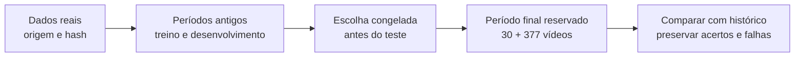

# Dados reais: o modelo funciona melhor que o histórico?

**Ainda não demonstrou uma vantagem consistente.** Treinamos e testamos os preditores em duas bases públicas reais. A proposta anterior, CatBoost residual, ficou próxima de uma referência simples no erro médio. A seleção automática entre modelos também não produziu uma melhoria confiável.

Isso muda a conclusão do case: existe uma implementação executável e agora existe um teste real, mas **a eficácia do modelo continua sem comprovação para o uso da Galaxies**. Os bons resultados sintéticos anteriores não se repetiram de forma consistente. Não há fundamento para apresentar a solução como “nota 10”.

Execução: **17 de outubro de 2026**. Nenhum resultado deste estudo foi promovido para uso em produção.

## A comparação em linguagem simples

A referência faz uma previsão usando o desempenho anterior do canal, ajustado pelo histórico da categoria quando há poucos exemplos. O modelo recebe esse contexto e tenta melhorar a previsão usando o título e, quando disponível, a duração do vídeo.


O gráfico usa uma **tolerância ampla**: se um vídeo recebeu 1.000 visualizações, uma previsão entre aproximadamente 500 e 2.000 entra na faixa. Isso não significa prever o número exato nem ter essa porcentagem de “precisão”. A fórmula usa `contagem + 1` para lidar com zeros.

| Previsões dentro dessa faixa | Ken Jee: 30 vídeos de teste | Trending: 377 vídeos de teste |
|---|---:|---:|
| Histórico ajustado | **21 de 30 — 70%** | **188 de 377 — 49,9%** |
| CatBoost residual, a proposta anterior | 15 de 30 — 50% | 177 de 377 — 46,9% |
| Modelo escolhido no desenvolvimento | 20 de 30 — 66,7% | 153 de 377 — 40,6% |

“Proposta anterior” significa a mesma formulação e implementação do regressor, **treinada novamente nos dados reais**. Não usamos os pesos aprendidos na simulação para prever outra população. O teste público tem um adaptador de atributos próprio, pois essas bases não oferecem os vídeos completos nem as mesmas modalidades da aplicação.

Também medimos o tamanho do erro, para não depender apenas da faixa do gráfico:

| Erro absoluto médio em visualizações; menor é melhor | Ken Jee | Trending |
|---|---:|---:|
| Histórico ajustado | **4.155** | **3.415.037** |
| CatBoost residual | 4.207 | 3.424.375 |
| Modelo escolhido no desenvolvimento | 4.244 | 3.564.429 |

Nesse critério, o CatBoost residual errou **1,2% a mais** que o histórico ajustado no Ken Jee e **0,3% a mais** no Trending. São diferenças pequenas; não representam evidência de superioridade do modelo. Os erros grandes do Trending refletem também a escala de vídeos populares e a influência dos maiores desvios.

As outras referências também estão nos relatórios, sem escolher apenas a comparação mais favorável: a mediana do canal sem ajuste ficou dentro da faixa em **20/30** e **202/377** vídeos; os regressores que usam somente contexto ficaram em **2/30** e **189/377**. Vencer o regressor de contexto que falhou no Ken Jee, isoladamente, esconderia a força da referência simples.

## Um exemplo concreto de previsão

Estes são os **três primeiros vídeos do teste Ken Jee em ordem de publicação**, não uma seleção dos melhores acertos. Os números são visualizações na semana de calendário definida abaixo, arredondados para inteiros.

| Vídeo / publicação | Resultado real | Histórico ajustado | CatBoost residual | Modelo escolhido |
|---|---:|---:|---:|---:|
| `SaWxVk7rDp4` · 13/05/2021 | 2.711 | 4.307 | 5.652 | 1.801 |
| `8nTmuKI2oyA` · 14/05/2021 | 4.590 | 4.307 | 7.290 | 2.507 |
| `KU__lDJj5iU` · 22/05/2021 | 5.559 | 4.662 | 7.412 | 1.765 |

No primeiro vídeo, o modelo escolhido se aproximou mais do resultado. Nos dois seguintes, o histórico ajustado ficou mais perto. **Há acertos pontuais; o conjunto não mostra uma melhoria consistente.** As previsões de todos os vídeos estão salvas localmente em `.runtime/reports/public/{kenjee,trending}/test_predictions.csv`.

## Quais dados foram usados

| Base pública | Recorte utilizado | O que tentamos prever | Limitação principal |
|---|---|---|---|
| [Ken Jee, exportação do próprio criador](https://www.kaggle.com/datasets/kenjee/ken-jee-youtube-data), versão 2 | 196 vídeos com sete registros diários completos, de 223 vídeos datados; um canal; 2019–2022 | Soma das visualizações na data de publicação e nas seis datas seguintes | Um único criador de conteúdo de ciência de dados, em inglês |
| [YouTube Trending, DataSnaek](https://www.kaggle.com/datasets/datasnaek/youtube-new), versão 115 | 2.534 vídeos de 1.191 canais; EUA, Canadá e Reino Unido; 2017–2018 | Visualizações acumuladas no snapshot datado sete dias após a data de publicação | Só vídeos que apareceram cedo no Trending e continuavam presentes nessa data |

**Nenhum dos dois alvos equivale a uma medição exata após 168 horas.** Ken Jee fornece datas, sem horário/fuso verificado; exigimos todos os sete dias e não preenchemos ausências com zero. No Trending, o horário do snapshot é desconhecido: a idade do vídeo nessa observação fica aproximadamente entre seis e oito dias. Os dois estudos são separados; não misturamos seus alvos.

O Trending partiu de 120.746 linhas e 30.318 IDs únicos nas três regiões. Exigimos o primeiro snapshot no dia da publicação ou no seguinte e um snapshot no dia de calendário +7. Restaram 2.538 vídeos; removemos quatro duplicatas por canal/título normalizado. Isso produz **forte viés de seleção e sobrevivência**. Seu histórico é o histórico disponível nesse recorte, não todos os uploads do canal. Não representa o YouTube inteiro, publicidade brasileira ou os setores beleza, moda e automotivo.

O Ken Jee também exclui vídeos com dias ausentes; a população completa do canal não pode ser presumida idêntica à amostra elegível. Nas duas bases, a distribuição paga é desconhecida. Títulos exportados retrospectivamente podem ter sido editados; não há prova de que sejam a versão original anterior à publicação. Portanto, este é um **teste retrospectivo de metadados**, não uma validação integral da promessa de prever antes de publicar.

As condições declaradas pelos publicadores foram registradas: Ken Jee usa “Other”, compartilha os dados para análise e faz referência aos termos do YouTube; Trending declara CC0. Esses registros descrevem as fontes e não estabelecem uma autorização geral para reutilizar vídeos ou dados de terceiros em um produto comercial. Os arquivos brutos não são redistribuídos no Git.

Também auditamos [SMTPD, dos autores do trabalho CVPR 2025](https://huggingface.co/datasets/zw773577332/SMTPD). Seu CSV público não contém datas de publicação, e parte dos atributos numéricos já está padronizada. Foi descartado deste teste temporal: não inventamos datas nem usamos a ordem das linhas como cronologia. [MicroLens](https://github.com/westlake-repl/MicroLens) não foi baixado: timestamps de interação não estabelecem publicação e contagem no mesmo horizonte. Veja o [registro das fontes](results/public/sources.json).

## Como evitamos uma comparação enganosa



| Etapa | Ken Jee | Trending |
|---|---:|---:|
| Treino final | 104 vídeos | 1.288 vídeos |
| Validação para parada do treino | 27 | 310 |
| Calibração dos intervalos | 28 | 287 |
| Teste final reservado | 30 | 377 |
| Publicações no teste final | 13/05/2021–10/01/2022 | 30/04/2018–07/06/2018 |

As partições respeitam publicação e disponibilidade do resultado; vídeos cujo alvo ainda não estaria disponível na fronteira são expurgados. Por isso os totais não somam toda a base. No Ken Jee, assumimos disponibilidade na data de publicação +8 dias, com um dia adicional para atraso do relatório; isso é uma convenção conservadora, não um timestamp de coleta observado. No Trending, assumimos o fim do dia de cada snapshot.

O desenvolvimento comparou **12 configurações de Ridge, CatBoost, LightGBM e blend em duas janelas futuras**, com treino crescente. Usamos duas, em vez das três do protocolo sintético, para preservar os mínimos de amostra das partições depois do expurgo. A escolha foi **CatBoost com maior profundidade no Ken Jee** e **Ridge regularizado no Trending**. A referência aprendida só de contexto também foi escolhida antes do teste. O CatBoost residual anterior foi declarado antecipadamente como comparação adicional.

A regra de seleção permaneceu a mesma: prioriza ordenação entre vídeos do mesmo canal publicados em uma janela de 14 dias, considera a incerteza entre janelas, limita erro de contagem em log dentro do grupo competitivo e prefere menor complexidade. **Ela falhou em selecionar um ganho consistente nestes dados.** No Trending, havia apenas 18 e 8 pares nas janelas de desenvolvimento; no Ken Jee, 53 e 12. Uma regra apoiada em tão poucos pares é instável. Essa observação será uma hipótese para um novo estudo, não motivo para alterar o modelo e reutilizar este teste como confirmação.

O histórico é calculado com resultados disponíveis estritamente antes de cada previsão. Usa os últimos 20 vídeos elegíveis do canal; a versão ajustada combina a mediana deles com a mediana anterior da categoria, com peso do canal `n / (n + 5)`. Sem histórico local, usa a categoria. Resultados de vídeos anteriores dentro do período de teste podem entrar no histórico **apenas depois de maduros**, como ocorreriam numa operação contínua; os pesos dos modelos ficam fixos.

Nenhuma visualização, curtida, comentário, CTR ou retenção do próprio vídeo entra como atributo. Totais futuros de inscritos e receita também são excluídos. Hashing de título e projeção SVD, categorias, imputação e escala são ajustados só no treino. Não há frames, transcrição, áudio, embedding visual ou rubrica semântica neste teste.

O estudo reutiliza `PointEstimator`, `ChannelHistory`, o catálogo de candidatos e as métricas da aplicação. O adaptador público fica separado de `PostRecord`: não inventa setores nem precisão de datas para satisfazer um contrato que os dados não atendem. Quantis são treinados separadamente e calibrados em uma partição exclusiva; aqui não há calibração por setor.

## Ordenação e incerteza também foram verificadas

| Diagnóstico final | Ken Jee | Trending |
|---|---|---|
| CatBoost residual: ordenação correta de pares | 12 de 16 — 75% | 12 de 25 — 48% |
| Modelo escolhido: ordenação correta de pares | 9 de 16 — 56,3% | 13 de 25 — 52% |
| Cobertura dos intervalos nominais de 90%, modelo escolhido | 100% | 84,9% |
| Largura média desses intervalos, em visualizações | 32.625 | 7.500.121 |

Esses pares podem compartilhar vídeos e não são observações independentes. **75% em apenas 16 pares de um único canal não comprova a capacidade de escolher melhores criativos.** No Trending, o intervalo bootstrap do ganho macro de ordenação do escolhido contra o contexto vai de −7,1 a +33,3 pontos percentuais: inclui ausência de ganho.

Para erro em log, o ganho do modelo escolhido sobre a mediana simples do canal também não ficou estabelecido: intervalo de 95% de −0,148 a +0,127 no Ken Jee e de −0,171 a +0,002 no Trending. O sinal positivo indica redução do erro. No Ken Jee, reamostramos oito blocos de publicação de 28 dias; no Trending, 280 canais. São estimativas condicionais à amostra, com dependências temporais remanescentes, não garantias de generalização.

Contra o regressor de contexto, o modelo escolhido no Trending **piorou** o erro macro em log: ganho estimado −0,064, intervalo de −0,117 a −0,009. No Ken Jee, superou esse regressor, mas não estabeleceu vantagem sobre a mediana simples. As unidades macro e o erro médio por vídeo são medidas diferentes; ambas estão nos JSONs.

Intervalos muito largos podem cobrir quase tudo e ainda ajudar pouco. No Ken Jee, a largura média acima de 32 mil visualizações contrasta com uma mediana de resultados reais de 3.408. No Trending, a cobertura ficou abaixo dos 90% pretendidos. O recorte de 92 vídeos sem histórico de canal teve apenas 32,6% das previsões do modelo escolhido dentro da faixa de metade a dobro. Esses resultados não sustentam uso operacional.

## Reproduzir e inspecionar

Em um checkout novo, com `uv`, Python e OpenMP disponíveis:

```bash
uv sync --frozen --group dev
uv run python scripts/run_public_benchmark.py download kenjee
uv run python scripts/run_public_benchmark.py audit kenjee
uv run python scripts/run_public_benchmark.py develop kenjee
uv run python scripts/run_public_benchmark.py final kenjee

uv run python scripts/run_public_benchmark.py download trending
uv run python scripts/run_public_benchmark.py audit trending
uv run python scripts/run_public_benchmark.py develop trending
uv run python scripts/run_public_benchmark.py final trending

uv run python scripts/render_public_results.py
```

`download` usa versões públicas, registra hashes e extrai só os arquivos esperados. Dados ficam em `.runtime/public/`; modelos, previsões e relatórios de novas execuções em `.runtime/reports/public/`. A figura lê os relatórios desta execução, versionados em `docs/results/public/`, e não substitui silenciosamente a evidência por outra execução.

`develop` exige um diretório novo. `final` verifica hashes de dados, código, plano e seleção e cria um registro exclusivo de abertura. **Não apague esse registro para ajustar o modelo ao teste.** Reproduzir em outro checkout verifica a execução; não transforma os mesmos resultados em uma nova validação independente. Os modelos nativos e parâmetros do encoder são preservados para inspeção local, sem registro ou ativação na aplicação.

| Artefatos auditáveis | Ken Jee | Trending |
|---|---|---|
| Plano, origem, hashes e partições | [Plano](results/public/kenjee/plan.json) | [Plano](results/public/trending/plan.json) |
| Todas as configurações no desenvolvimento | [Desenvolvimento](results/public/kenjee/development.json) | [Desenvolvimento](results/public/trending/development.json) |
| Escolha congelada | [Seleção](results/public/kenjee/selection.json) | [Seleção](results/public/trending/selection.json) |
| Métricas finais completas, inclusive desfavoráveis | [Teste final](results/public/kenjee/final.json) | [Teste final](results/public/trending/final.json) |
| Hashes dos arquivos utilizados | [Proveniência](results/public/kenjee/provenance.json) | [Proveniência](results/public/trending/provenance.json) |

A implementação passou por 62 testes automatizados, além de Ruff, formatação e build. Sete testes novos verificam a preparação pública, ausência de vazamento futuro, ajuste do encoder só no treino, duplicatas, congelamento e abertura única do teste. Os testes de software usam fixtures artificiais; **os resultados deste relatório vêm das bases reais**, em execuções separadas.

## O que este resultado muda na próxima hipótese

O histórico ajustado deve continuar como referência obrigatória. Não há evidência aqui para justificar a complexidade adicional do preditor com título. O próximo estudo precisa testar se representações semânticas de vídeos originais, transcrição e áudio acrescentam sinal em uma população pertinente à Galaxies, com versões anteriores à publicação verificadas e distribuição conhecida.

Antes de abrir outro período final, será necessário definir uma regra de seleção que exija ganho sobre referências simples em contagens e ordenação, e uma amostra com pares suficientes. Os resultados deste estudo servem para formular essa hipótese; **uma nova avaliação precisará de dados ainda não usados para tomar essas decisões**. Para afirmar que editar o criativo melhora uma campanha, também será necessário um experimento controlado: previsão retrospectiva, mesmo boa, não demonstra causalidade.
