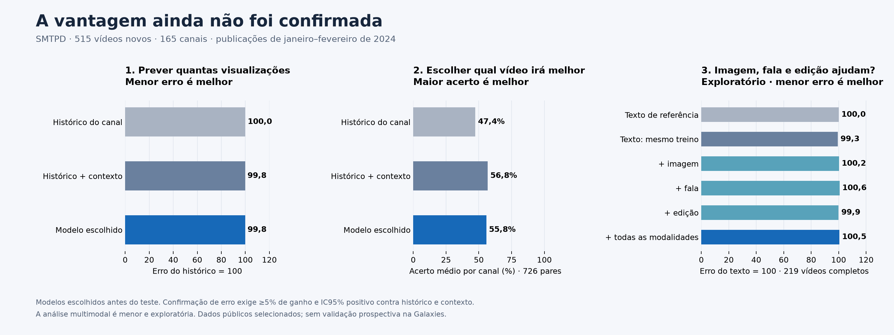

# Conseguimos superar o histórico do canal?

**A vantagem ainda não foi confirmada.** Este é o resultado de um teste reservado com **515 vídeos de 165 canais**. Os modelos foram escolhidos antes de consultar suas visualizações finais.



## 1. Prever o número de visualizações

| Previsão | Erro em log por canal ↓ | Se o erro do histórico é 100 ↓ | Erro de até um fator 2 |
|---|---:|---:|---:|
| Histórico do canal | 0.6868 | 100,0 | 64,7% |
| Histórico + contexto | 0.6854 | 99,8 | 65,0% |
| Modelo escolhido | 0.6856 | 99,8 | 65,4% |

A redução do erro foi **0,18% contra histórico** e **-0,03% contra contexto**. Valor negativo significa piora. Isso mede erro da previsão; não representa aumento causado nas visualizações.

O critério pré-registrado de redução do erro **não foi cumprido**. Uma diferença pequena ou incerta não será apresentada como ganho comprovado.

A incerteza foi calculada reamostrando canais inteiros, 5.000 vezes. Ganho absoluto de erro contra histórico: **0.0012**, IC95% **[-0.0260; 0.0273]**. Contra contexto: **-0.0002**, IC95% **[-0.0135; 0.0126]**. Positivo significa melhora; um intervalo que cruza zero não confirma vantagem.

### Seis exemplos com números de visualizações

| Vídeo | Histórico previa | Contexto previa | Modelo previa | Real na primeira semana |
|---|---:|---:|---:|---:|
| [oEFO0m8WA2o](https://www.youtube.com/watch?v=oEFO0m8WA2o) | 9 | 16 | 15 | 2 |
| [lws0iLwpoxI](https://www.youtube.com/watch?v=lws0iLwpoxI) | 6 | 8 | 7 | 1 |
| [TotUeumIFWo](https://www.youtube.com/watch?v=TotUeumIFWo) | 5.089 | 5.555 | 5.570 | 4.162 |
| [YHBj7uWWCts](https://www.youtube.com/watch?v=YHBj7uWWCts) | 117.766 | 109.028 | 100.027 | 102.860 |
| [pnQqGEqo6jw](https://www.youtube.com/watch?v=pnQqGEqo6jw) | 56.271 | 69.579 | 73.464 | 36.366 |
| [wp4IbbXD1lc](https://www.youtube.com/watch?v=wp4IbbXD1lc) | 21.363 | 23.885 | 21.306 | 11.584 |

Os exemplos são escolhidos pela ordem do hash do ID, independentemente de o modelo acertar ou errar. Os números previstos foram arredondados; a [tabela completa](results/smtpd/final/test_predictions.csv) preserva todos os 515 casos. Links podem ficar indisponíveis; a contagem real vem da coleta histórica, não do contador atual do YouTube.

## 2. Escolher entre vídeos do mesmo canal

| Previsão | Acerto médio por canal ↑ |
|---|---:|
| Histórico do canal | 47,4% |
| Histórico + contexto | 56,8% |
| Modelo escolhido | 55,8% |

Foram **726 pares de 54 canais**, comparando publicações na mesma semana. A seleção do ordenador foi separada da previsão numérica. O critério de confirmação da ordenação **não foi cumprido**.

Esses são pares observados de vídeos publicados, não um experimento causal de trocar um roteiro por outro. Acertar qual vídeo vai melhor não significa acertar seu número de views.

## 3. O vídeo completo acrescenta valor?

Comparação nos **219 vídeos completos acessíveis de até três minutos**, de **63 canais**. Todos recebem as mesmas referências. O controle de texto usa o mesmo subconjunto de treino da análise de mídia.

| Informação acrescentada | Erro na escala em que o texto vale 100 ↓ |
|---|---:|
| Texto de referência | 100,0 |
| Texto: mesmo treino | 99,3 |
| + imagem | 100,2 |
| + fala | 100,6 |
| + edição | 99,9 |
| + todas as modalidades | 100,5 |

A diferença do modelo com todas as modalidades contra texto foi **-0,5% de redução de erro**, IC95% absoluto **[-0.0183; 0.0099]**. **Este recorte é exploratório e não alcança os 500 vídeos exigidos para uma confirmação ampla.** O melhor candidato real de cada modalidade foi congelado antes do teste, mesmo quando perdera para o fallback na validação.

O áudio foi transcrito integralmente. O detector de edição decodificou todos os frames. O encoder visual usou imagens distribuídas pelo vídeo, além dos primeiros segundos. Incluímos ritmo de cortes, fala de abertura, relação título–fala e similaridades visuais com conceitos definidos previamente; não são rótulos humanos de qualidade ou viralidade.

## Por que este teste é mais próximo do case

Usamos a [SMTPD, CVPR 2025](https://arxiv.org/abs/2503.04446), com acompanhamento diário desde a publicação. Recuperamos datas e canais estáveis pela API oficial, sem usar popularidade atual. O alvo é a contagem nominal na primeira semana. Cada resultado só entra no histórico após oito dias, incluindo margem conservadora.

O treino principal tem **796 vídeos com histórico**; a regressão de diferenças também aproveita publicações anteriores de canais repetidos. A calibração usa **129 vídeos separados**. Investigamos ainda 40.781 vídeos anteriores de outros setores, com controles de peso e ausência de transferência. Tentativas que não ajudaram permanecem registradas.

Escolha para erro: `media/editing:tree3@0.25`. Referência histórica: `base/logmean_20`. Contexto: `auxiliary/aux_context0_ridge100@0.5`. Escolha para ordenação: `base/retrieval_d3_median_20@1`. Os nomes técnicos servem para reprodução; o resultado útil está nas três comparações acima.

## O que continua sem validação

- A base é selecionada, tem histórias incompletas e exclui dias ausentes e extremos de popularidade. Vídeos removidos desde a coleta não puderam ser recuperados.
- Howto & Style inclui temas além de moda e beleza. A mídia e o título podem ter mudado desde a publicação.
- Não existe alvo de curtidas no mesmo horizonte nesta fonte. Não há confirmação prospectiva em canais da Galaxies nem autorização técnica para promover o modelo como produção validada.
- Os resultados anteriores, inclusive negativos, continuam publicados: [2016](REACH_RESULTS.md), [transferência entre épocas](TRANSFER_RESULTS.md), [adaptação recente](RECENT_ADAPTATION_RESULTS.md) e [retenção com vídeo completo](FULL_VIDEO_RESULTS.md).

## Decisão e próximo investimento que faz sentido

**Não promover este modelo como superior ao histórico.** A extração funciona, mas sua utilidade preditiva não foi demonstrada. O intervalo nominal de 90% do modelo cobriu **88,9%** dos resultados; isso não substitui o critério de ganho sobre as referências.

As tentativas de ampliar texto, transferir 40.781 vídeos, ponderar a transferência e treinar diretamente para ordenação já foram implementadas e não justificaram adoção. Alterar mais hiperparâmetros com os mesmos dados de teste criaria uma comparação contaminada. Uma nova avaliação exigirá novos dados reservados.

O próximo investimento com potencial material é obter **histórico completo de canais do domínio e resultados observados em horizonte fixo**, ligados ao vídeo original, separando mídia paga, republicações e mudanças de estratégia. O repositório já tem coleta de snapshots e registro prospectivo; esses componentes podem ser reutilizados quando houver essa fonte. A base da Academy não existe e nenhuma fonte acessível resolveu essa lacuna nesta investigação. Não há evidência para prometer que outro modelo maior corrigirá o problema.

## Conferir e reproduzir

[Previsões individuais](results/smtpd/final/test_predictions.csv) · [Resultado integral](results/smtpd/final/final.json) · [Escolha congelada](results/smtpd/final/selection.json) · [Verificação independente](results/smtpd/final/verification.json) · [Protocolo e desenvolvimento](SMTPD_PROTOCOL.md).

Os números e intervalos foram recalculados diretamente das previsões. A separação temporal e a disponibilidade do histórico foram verificadas com implementação independente.

```bash
uv run python scripts/verify_smtpd_results.py
uv run python scripts/render_smtpd_results.py
```

O comando de avaliação final recusa uma segunda abertura. Para conferir o resultado, use os arquivos publicados e a verificação; não apague o registro de abertura para tratar uma repetição como dado novo.
